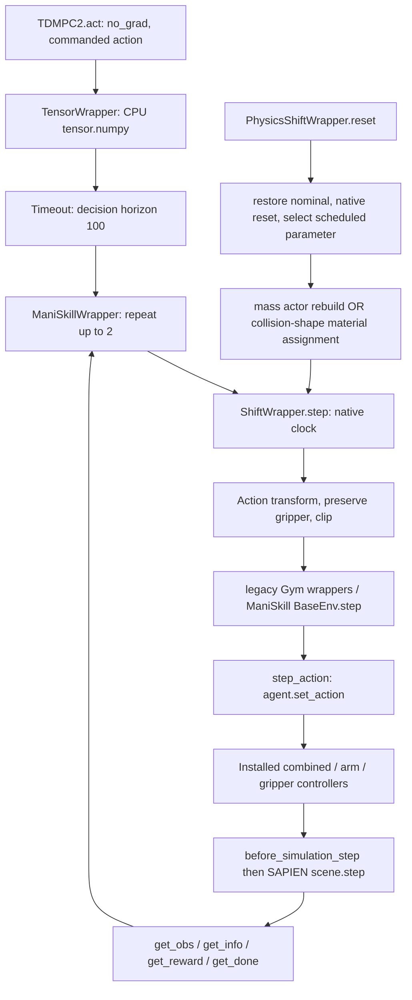

# TD-MPC2 × ManiSkill2 Dynamics Shift 감사

작성일: 2026-10-27. 검토 기준 commit: `67be304a26508976a146af5556254a5869ba7574`.

## 서버 결과 수신 후 갱신 — 2026-10-27

**이 절이 아래 최초 로컬 감사의 자료 부재에 따른 판정을 대체한다.** 아래 1~10절은
서버 자료 수신 전의 분석 기록으로 보존한다. 기존 benchmark와 입력 JSON은 수정하지 않았다.
이번 검토는 사용자가 전달한 서버 감사 JSON을 분석한 것이며, 로컬에서 simulator를 재실행하거나
원본 trajectory를 다시 감사한 것은 아니다.

### 실제 검증 판정

- **PASS — identity 21/21:** seeds 17/18/19 × disabled 반복 재현성, factory disabled,
  enabled nominal, gain 1, delay 0, mass 1, friction 1. 각각 100 native steps.
  reset 비교도 모두 일치하며 observation/reward/done/success/public simulator state의
  최초 divergence는 모두 null. 허용 오차 atol=1e-6, rtol=0; 불리언은 정확히 비교.
  해당 seed/action sequence 범위의 증거이며 모든 정책 trajectory를 보증하지 않는다.
- **PASS — 물리 보존·복원 6/6:** 각 seed에서 mass/friction ×0.5 변경 및 복원.
  mass는 0.0640000030 → 0.0320000015 kg, principal inertia도 절반.
  COM/pose/velocity/angular velocity/reference slots 및 mass의 shape 비교 통과.
  shallow stale reference 없음, 복원 속성 및 reset/복원 rollout identity 통과.
  모든 nested reference·solver cache의 보존까지 인증한 것은 아니다.
- **PASS — controlled contact response 2/2:** seed 17의 mass 및 friction probe에서
  nominal 반복 오차 0, nonzero object contact 관측, ×0.5/×1.5 trajectory 차이 확인.
  이는 물리 변경이 반응에 영향을 준다는 증거이다. 마찰 계수의 정량적 동정,
  combine rule 검증, 실제 policy trajectory의 물리 타당성 전체를 입증하지 않는다.
- **PASS — 15 runs의 completion/trace contract/action exposure 검사:** E0 2개와
  13개 shift 조건. 기록된 checkpoint 종료 hash 확인도 모두 PASS.
  action formula는 E4를 제외하고 PASS. E6/E7 cached readback 검사 모두 PASS.
- **UNVERIFIED — E4 action formula:** 원본 metadata에 clipping bounds가 없어
  saturated action의 차이를 도구가 인증하지 못함. 이는 구현 오류 판정이 아니다.
  이번 simulator의 bounds는 [-1,1]^4지만 과거 run의 측정 bounds로 소급 취급하지 않는다.
- **UNVERIFIED — paired initial observation:** 호환 E0가 2개이므로 도구가 reference를
  선택하지 않아 비교를 수행하지 않았다. 불일치를 발견한 것이 아니다.
  full simulator/controller/RNG pairing은 원본 로그에 기록이 없어 별도로 미검증.
- **UNVERIFIED — 과거 run live physics readback 및 메모리 내 model weight 불변:**
  cached readback/파일 hash와 해당 증거는 서로 다르다.

두 JSON에서 FAIL 항목은 발견되지 않았다. top-level UNVERIFIED는 부분 검사 PASS와
양립하며, 이를 전체 검증 실패 또는 전체 인증으로 해석해서는 안 된다.

### 설치본으로 확인한 API 및 시간 단위

ManiSkill2 0.4.1, SAPIEN 2.2.1, gym 0.21.0, torch 2.7.1.
실제 보고된 sim_freq=500 Hz, control_freq=20 Hz, sim_steps_per_control=25.
따라서 native step=50 ms, physics step=2 ms, 정상적인 2회 repeat decision=100 ms.
Delay 1/2는 각각 50/100 ms이며 success로 repeat가 중단되면 decision 길이가 짧아진다.

설치본 method source: agent.set_action → CombinedController의 arm/gripper 분할 →
PDEEPosController.set_action → action 전처리 → target pose 및 IK → drive targets.
그 뒤 매 native step에서 25회 agent.before_simulation_step → scene.step.
arm config는 normalize_action=True, lower/upper=-0.1/0.1, frame='ee',
use_delta=True, use_target=False, interpolate=False이다. 즉 정규화된 arm 입력은
현재 end-effector 좌표계의 위치 delta로 사용되며, 이전 target의 누적 명령이 아니다.
IK 실패 시 현재 시작 qpos로 fallback한다. gripper는 absolute joint position 명령이다.
get_done은 bool(info['success'])를 반환한다.

actor get_mass/get_inertia/get_builder는 노출되지만 set_mass/set_inertia/
set_mass_and_inertia는 모두 미노출로 기록됐다. 현재 actor 재생성 경로가 시험된 것이며,
직접 runtime mass setter 지원이 검증된 것은 아니다. 물리 wrapper는 계속 reset-time 적용이다.
JSON에 포함된 method source/config는 읽었지만 복사된 설치 소스 전체와 SAPIEN C++는
이번 첨부에 포함되지 않았다. simulator 감사 JSON에는 repo source hash 증명이 없어
과거 benchmark와 simulator 검사 시점의 wrapper byte-for-byte 일치는 별도 미검증이다.

### 조건별 실제 결과

각 run은 50 episodes. 아래 통계는 전달된 log_audit.json의 episode 항목에서 재계산했다.
노출 비율은 parameter가 nominal과 다른 native step의 비율이며, action 차이 비율과 다르다.

| 조건 | 성공률 | 평균 return | 평균 decision 길이 | 노출 episode | 노출 native steps |
|---|---:|---:|---:|---:|---:|
| E0 | 98% | 30.555 | 9.80 | 0/50 | 0/940 (0.00%) |
| E0 | 98% | 30.555 | 9.80 | 0/50 | 0/940 (0.00%) |
| E1-g05 | 96% | 51.823 | 19.32 | 50/50 | 1897/1897 (100.00%) |
| E1-g07 | 98% | 42.520 | 13.86 | 50/50 | 1344/1344 (100.00%) |
| E1-g09 | 100% | 32.574 | 8.64 | 50/50 | 817/817 (100.00%) |
| E2-global | 100% | 40.634 | 12.20 | 45/50 | 1079/1179 (91.52%) |
| E2-mid | 98% | 30.180 | 9.76 | 1/50 | 100/936 (10.68%) |
| E3 | 98% | 33.898 | 11.58 | 28/50 | 520/1120 (46.43%) |
| E4 | 100% | 31.264 | 8.56 | 50/50 | 808/817 (98.90%) |
| E5-d1 | 90% | 60.129 | 26.38 | 50/50 | 2635/2635 (100.00%) |
| E5-d2 | 38% | 142.897 | 78.68 | 50/50 | 7853/7853 (100.00%) |
| E6-m05 | 96% | 32.566 | 11.20 | 50/50 | 1081/1081 (100.00%) |
| E6-m15 | 96% | 36.315 | 12.78 | 50/50 | 1238/1238 (100.00%) |
| E7-f05 | 94% | 35.286 | 13.68 | 50/50 | 1325/1325 (100.00%) |
| E7-f15 | 100% | 32.449 | 8.80 | 50/50 | 843/843 (100.00%) |

E0 두 행은 서로 다른 run이며 합쳐서 독립 100회 실험으로 취급하지 않는다.
두 run의 집계 통계가 같다는 것만으로 trajectory/초기 상태가 같다고 추정하지 않는다.

**E2-mid의 98%는 mid-episode shift에 대한 강건성 근거로 제외한다.**
노출 episode는 id=21(seed=22) 단 하나이고 success=0, 100 decisions/200 native steps 중
마지막 100 native steps만 노출됐다. 첫 shift timestamp는 global native index 432
(episode-local 100)이다. 나머지 49개는 미노출 상태에서 종료됐다.
노출된 1개의 성공률 0% 역시 표본 수와 생존 선택 때문에 전체 조건의 성능 추정치로 삼지 않는다.

E5-d2는 성공률 38%, 평균 길이 78.68로 명확한 성능 저하를 보여주는 frozen delay
stress-test 후보다. 평균 return 142.897이 E0보다 높아도 성능 향상으로 해석하면 안 된다.
성공 종료와 누적 dense reward 때문에 긴 실패 episode가 높은 return을 가질 수 있으므로
success 및 length와 함께 보고한다. 50 episode 한 run으로 학습 seed 간 유의성은 주장하지 않는다.

### 연구 사용 범위와 후속 조치

- E0, E1, E5: 현재 자료로 **기술적 frozen baseline 결과**를 보고할 수 있다.
  paired controlled comparison 인증은 reference 선택 및 초기 상태 증거가 보강될 때까지 보류한다.
- E6/E7: 물리 효과 자체의 증거는 확보됐다. **reset-time mass+inertia/material perturbation의
  예비 frozen baseline**으로 한정해 보고 가능하다. 질량만 변경했다고 쓰거나 mid-episode
  intervention으로 쓰지 않는다. nested reference, live readback, source provenance 한계를 병기한다.
- E2-global/E3: 노출이 섞인 schedule-level 결과로만 보고한다. post-shift 전용 성공률이나
  동일 노출량의 adaptation 비교로 사용하지 않는다. episode별 phase/exposure를 함께 제시한다.
- E4: schedule trace 노출은 확인됐지만 clipped action 공식 검증을 마치기 전
  fully audited actuator condition으로 사용하지 않는다.
- E2-mid: 현재 aggregate를 abrupt-shift robustness 증거에서 제외한다.
- 모든 조건: frozen 결과를 world-model adaptation의 효과 또는 world model 실패 원인의
  증거로 사용하지 않는다. 별도 adaptation 및 원인 분리 실험이 필요하다.

다음 검증에는 최초 공유한 E0 run `E0-action_gain-nominal-20261027T074121-f841a79bd7`를
reference로 명시하여, 그 E0와 13개 shift run만 포함한 별도 수집 디렉터리에서
`audit_shift_logs.py`를 다시 실행하면 observation pairing의 모호성을 제거할 수 있다.
원본 E0를 삭제하거나 기존 결과를 덮어쓰지 않는다. 이 재감사에도 simulator 재실행은 필요 없다.
full initial-state pairing은 이 방법으로 복구되지 않으며 향후 실험의 별도 기록 항목이다.

### 입력 증거

- `audits/audit-20261027T112925-6773a02e/simulator_audit.json` — SHA256 `cf0e40fffd6abe20ec7d1a5bfd634dc09e9c199815a14c3118b12484e24fb434`
- `audits/audit-20261027T112937-7f3ac48e/log_audit.json` — SHA256 `15877a7dfdef3042daa618638f1f6b5a5a595afdb6425dd127fda19feda7e6fb`

---

## 최초 로컬 감사 기록 (서버 자료 수신 전)

## 1. 결론과 증거 범위

**현재 자료만으로 E0~E7 성공률을 world-model adaptation의 효과·필요성을 입증하는
결과로 사용할 수 없다.** Frozen robustness baseline 후보와 adaptation 증거를 구분해야 한다.

- 사용자 제공 E0 콘솔: 50 episodes, success 0.98, return 30.554829 ± 12.019207,
  decision length 9.8 ± 13.095037, shift_events 0. 이 수치는 사용자 제공 기록이며,
  이번 감사가 서버에서 재실행하거나 원본 CSV로 재계산한 결과가 아니다.
- E1~E7 원본 결과, E0 원본 JSON/CSV/NPZ, 서버 설치 ManiSkill2/SAPIEN 코드는 로컬에 없다.
  사용자만 원격접속 가능하므로 원격 검증을 시도하지 않았다.
- 로컬 구현·설정·테스트를 검토했고, 과거 확보한 공식 v0.4.1 BaseEnv/Panda 설정 소스를
  참고했다. **공식 버전 소스는 서버에 실제 설치된 코드의 증거가 아니다.**
- 이번 작업은 감사 보고서·독립 감사 도구·감사 도구 테스트만 추가했다. 환경, 알고리즘,
  checkpoint, 기존 benchmark 결과를 수정하지 않았다. 기존 결과를 덮어쓰는 검증 스크립트도
  실행하지 않았다. 실제 환경 수정 전후 identity test는 구현 수정이 없으므로 해당 없음.

판정 의미:

- `PASS`: 해당 범위의 코드 또는 실제 수행된 검사에 한정해 증거가 있다.
- `FAIL`: 검사 실패 또는 명시한 연구 주장/검증 기준이 충족되지 않는다.
- `UNVERIFIED`: 자료·실행 환경이 부족하다. 통과도 실패도 추정하지 않는다.

## 2. 현재 판정표

| 검사 | 판정 | 근거/범위 |
|---|---|---|
| action shift가 agent 밖에서 적용됨 | PASS | `action_shift.py`가 native env 전달 전 변환; observation에 gain을 추가하지 않음 |
| Frozen 경로에 학습 호출 없음 | PASS | `evaluate_shift.py`는 `act`, `FrozenProtocol.observe` 호출; observe는 no-op. act/plan은 no_grad |
| 과거 실행의 메모리 내 model weight 불변 | UNVERIFIED | checkpoint 파일 hash와 메모리 parameter hash는 다른 증거; 전후 parameter hash가 없음 |
| action repeat/clock/reset/queue | PASS | 코드 및 NumPy fixture 테스트 범위. native 2회, done 시 1회로 종료 |
| 46개 지원 조합과 연속 delay 거부 | PASS | 기존 matrix 단위 테스트; simulator 물리 검증이 아님 |
| 서버 controller의 정규화·좌표계·IK·target 누적 | UNVERIFIED | 실제 설치 controller 소스를 아직 읽지 못함 |
| 실제 raw vs nominal/gain1/delay0/mass1/friction1 identity | UNVERIFIED | 로컬 simulator 부재. 새 서버용 검사 제공 |
| mass 변경의 readback·actor 교체 격리성 | UNVERIFIED | fixture 통과는 SAPIEN 검사 대체 불가 |
| E6를 질량만 변경한 실험으로 해석 | FAIL | 구현은 질량과 principal inertia를 함께 같은 배수로 변경 |
| E6 actor 재생성 안전성이 이미 검증됐다는 주장 | FAIL | 형상 개수/groups와 일부 속성만 검사. native round-trip identity 증거 없음 |
| friction 실제 접촉 효과·결합 규칙 | UNVERIFIED | reset material readback과 실제 접촉 반응은 별개 |
| reset-time physics를 mid-episode intervention으로 해석 | FAIL | 구현은 reset 시 값 선택 후 episode 내 유지 |
| reset-time sample-and-hold 구현 | PASS | `PhysicsShiftWrapper.current_parameter()`가 held value 반환; fixture 검증 |
| seed 일치만으로 full initial-state pairing을 인증 | FAIL | 기존 로그에 초기 simulator/controller/RNG state가 없음 |
| E0 실행 완료 | PASS | 사용자 콘솔에 50회 완료. 원본 파일 무결성/통계는 UNVERIFIED |
| E1~E7 실제 성공률·노출 비율·readback 감사 | UNVERIFIED | 원본 로그 미제공 |
| Frozen 성공률만으로 adaptation 효과를 주장 | FAIL | 실제 학습/비교 intervention을 수행하지 않음; 원인도 world model에 국한되지 않음 |

`FAIL` 행 중 연구 해석/검증 기준 실패는 실제 simulator transition이 틀렸다는 단정이 아니다.

## 3. 호출 경로와 적용 위치



### Repo에서 확인한 순서

1. `tdmpc2/tdmpc2.py:98`의 `act`가 모델/MPC로 commanded action을 계산한다.
   `eval_mode`를 별도로 true로 바꾸지 않아 기존 평가와 같은 확률적 inference 경로다.
   Frozen은 deterministic/greedy와 동의어가 아니다.
2. `TensorWrapper.step`은 CPU action을 NumPy로 변환한다. `Timeout.step`은 native 종료와
   100 decision time limit을 결합한다. timeout은 마지막 `info['terminated']`와 다를 수 있다.
3. `ManiSkillWrapper.step`은 동일 commanded action을 native env에 최대 두 번 전달한다.
   native done이면 두 번째 반복을 생략한다. reward는 두 native reward의 합,
   observation/success/info는 마지막 실행한 native step의 값이다.
4. action wrapper는 매 native call에 schedule 값을 구한다. Gain/bias/coupling/delay 적용 후
   native action bounds로 clip한다. 기본 gripper는 현재 command의 마지막 성분을 사용한다.
   Delay queue에는 clip 전 commanded action을 저장하고, 선택한 과거 arm action만 실행한다.
5. 명시적 reference v0.4.1 BaseEnv는 `step_action`에서 `agent.set_action`을 호출하고,
   `_sim_steps_per_control`회 `agent.before_simulation_step()` → `_scene.step()`을 실행한다.
6. BaseEnv는 obs/info/reward/done을 반환한다. reference BaseEnv의 `get_done`은
   `bool(info['success'])`이다. 이것이 서버에서도 동일한지는 설치 코드로 확인해야 한다.
7. `TensorWrapper`는 obs/reward를 tensor로 바꾸고 success를 float로 기록한다.
   4-value `(obs,reward,done,info)` 계약을 유지한다.

### Controller 의미: 확인한 내용과 남은 내용

reference Panda 설정은 `pd_ee_delta_pos`를 `PDEEPosControllerConfig`로 지정하고 arm 다음에
mimic gripper controller를 둔다. arm 위치 명령 lower/upper는 -0.1/+0.1로 설정되어 있다.
이는 torque gain을 직접 곱하는 코드가 아니다. Repo shift는 **controller 입력 공간**에서
명령을 변형한다.

다만 다음은 설치 소스 확인 전에는 수치·방식을 단정하지 않는다:

- 입력 [-1,1] 정규화/재clip의 정확한 순서와 실제 bound;
- delta의 좌표계, 현재 EE pose 기준인지 이전 target 기준인지;
- IK 실패·joint limit 처리, controller interpolation과 drive target 업데이트;
- gripper의 normalized command와 finger joint position mapping.

`audit_shift_simulator.py`는 실제 로드된 클래스/MRO·controller component의 설치 Python
파일을 복사하고 hash, 메서드 소스, controller config, action bounds를 저장한다.
따라서 이름만 보고 base-frame delta/±10 cm/torque scaling이라고 추정하지 않아도 된다.
SAPIEN C++ binding은 노출 메서드와 docstring을 수집하며, binary 내부 구현을 확인했다고 주장하지 않는다.

### 시간 단위

| 단위 | 의미 |
|---|---|
| native step | ManiSkill control step 1회. SAPIEN physics substep 1회가 아님 |
| policy decision | native 최대 2회; 종료가 첫 반복에서 나면 1회 |
| physics substep | `_scene.step()` 1회 |
| delay 1/2 | native command 1/2개 지연. 기본은 gripper 지연 없음 |

설치 값이 reference default control=20 Hz, sim=500 Hz와 같다면 native=50 ms,
physics=2 ms, 정상 decision=100 ms이다. Delay1=50 ms, Delay2=100 ms.
실제 주파수는 새 감사 JSON의 `control_freq`, `sim_freq`, `sim_steps_per_control`에서 확인한다.

예: decision command A,B가 `[A,A,B,B]`로 반복될 때 arm delay1은 `[0,A,A,B]`,
delay2는 `[0,0,A,A]`. startup zero는 기본 queue 초기값이며 gripper는 각 current command다.
Gain abrupt switch native=1이면 첫 decision 안에서 gain이 바뀔 수 있다.
E2-mid의 native=100은 50 decision이 완료된 뒤 다음 action부터 적용된다.

## 4. Identity 검사 설계

새 검사는 checkpoint나 학습을 사용하지 않는다. 실제 `ManiSkillWrapper`와 `Timeout`을
그대로 사용하고, native passthrough trace로 action repeat 내부도 기록한다.

조건: raw wrapper disabled, factory disabled, enabled nominal, fixed gain1,
fixed delay0, mass×1, friction×1. 동일 seed·원래 simulator state·controller state와
사전에 생성한 action sequence를 사용한다. 각 조건의 reset 직후 state/obs/controller가
같은지도 **state 복원 전에** 검사하여 차이를 숨기지 않는다.

- numeric observation/reward/public simulator state: 기본 `atol=1e-6`, `rtol=0`;
- success/done: 정확히 일치;
- shape/trajectory length: 정확히 일치;
- 최초 divergence에 native index, decision index, field, 최대 절대오차 기록;
- disabled 재실행 control도 먼저 비교. 그 자체가 불일치하면 다른 조건 결과는
  재현성 문제와 구분할 수 없으므로 `UNVERIFIED`로 낮춘다.
- controller state API 부재는 임의 우회하지 않고 `UNVERIFIED`로 남긴다.
- public simulator state가 solver/contact cache까지 포함한다고 주장하지 않는다.

로컬 결과: 실제 identity는 **UNVERIFIED**. fixture nominal equality를 실제 identity PASS로
기재하지 않았다. 실제 first divergence 역시 아직 계산할 수 없다.

## 5. 물리 API 및 격리성 감사

### Object mass

`physics_shift.py:63–89`는 retained builder로 **새 actor를 만든다**. mass와 inertia를
함께 scaling하고 pose/velocity/angular velocity/groups를 복사한 뒤 `env.obj` 및 `_actors`
캐시를 바꾸고 old actor를 제거한다. 이는 runtime mass setter가 아니다.

확인해야 할 항목:

- live mass/inertia/COM readback, 원래 mass와 inertia ratio;
- collision geometry, local pose, collision groups, physical materials;
- actor identity 교체로 남을 수 있는 nested reference/attachments/controller cache;
- damping, solver iteration, sleep/CCD/contact-offset 등 builder 이후 설정된 속성;
- .5/1.5 적용 후 nominal 복원 및 reset이 raw 환경과 같은 transition을 만드는지.

현재 production readback은 mass/inertia/COM만 수치 확인하고, 교체 직후 collision shape는
개수만 확인한다. shape geometry 동일성이나 모든 reference 보존을 입증하지 못한다.
`mass×1`은 rebuild branch를 실행하지 않으므로 그 identity만으로 E6 안전성을 인증할 수 없다.
새 검사는 기존 backend를 호출해 변경→복원→동일 rollout을 비교한다. direct/list/dict
reference만 검사하므로 deep reference 전체는 여전히 설치 코드 검토가 필요하다.

**권고:** 실제 round-trip과 actor 보존 검사가 통과할 때까지 E6를 제외한다. 미지원 runtime
setter를 만들거나 무시하지 않는다. 실패하면 builder를 이용한 task의 정상 construction 경로를
먼저 조사하고, 지원되는 경로가 없으면 해당 조건을 명시적으로 미지원 처리한다.
이번 감사에서는 새로운 재생성 우회 구현을 추가하지 않았다.

### Contact friction

기존 adapter는 object와 선택한 surface의 collision shape에 새 material을 배정한다.
static/dynamic friction을 함께 scaling하고 restitution을 보존한다. 공유 original material을
직접 변경하지 않는 점은 코드에서 확인된다. `@plane`은 정확히 한 plane actor를 요구한다.

- object 쪽 마찰 변경은 object–ground뿐 아니라 object–finger 접촉에도 영향을 줄 수 있다.
  E7를 단일 ground friction만 바꾼 실험으로 부르면 안 된다.
- 로그의 combine rule은 PhysX default에 관한 설명이다. 서버 pair의 effective combine mode를
  실제 조회한 값이 아니다. source/docstring·실제 pair/contact response를 따로 확인해야 한다.
- material readback 일치만으로 실제 sliding/grasp contact 변화가 입증되지 않는다.

`--contact-probe`는 native 호출 전에 동일한 외력을 주고 nominal 반복 재현성, 물체 궤적,
object contact/impulse, .5/1.5 response 차이를 기록한다. 알려진 API가 설치본에서 없으면
`UNVERIFIED`. 한 번의 force call이 모든 physics substep 동안 유지된다고 가정하지 않는다.
이는 controlled response diagnostic이며 task 성공률 실험 또는 마찰 계수 추정이 아니다.
차이가 없을 때도 '물리가 잘못됨'으로 단정하지 않고 excitation 부족 등을 남긴다.

### Reset-only 및 readback 한계

`PhysicsShiftWrapper.reset:140–146`에서만 parameter를 선택·적용한다. step에는 held value를
사용하며 `mid_episode_supported=false`다. global-native schedule을 선택해도 episode 중간
physics 변경은 없고 다음 reset에서 sample-and-hold한다.

`step:158`의 physics_readback은 reset 때 저장한 값을 복사한다. **매 timestep live readback이
아니다.** 현재 로그 감사의 readback PASS는 저장된 수치와 intended factor의 일치에 한정한다.

## 6. Shift timing과 실험 타당성

- Fixed gain/delay/physics는 shift event 0이어도 모든 step이 변경 parameter에 노출될 수 있다.
  `shift_events_mean`으로 exposure를 대신하면 안 된다.
- E2-mid: 성공 종료가 빠르면 native=100에 도달하지 않는다. E0 평균 9.8 decisions는
  낮은 노출 가능성을 보여 주지만 실제 E2 노출률은 원본 trace 없이는 계산할 수 없다.
  전체 success를 post-shift 성능으로 보고하지 말고 exposed/unexposed를 나눠 보고한다.
- 노출된 episode만 선택하면 '50 decisions까지 실패한 어려운 episode'가 선택될 수 있다.
  이를 unconditional baseline과 비교하면 selection bias가 있다. 동일 seed/초기조건·시점의
  matched comparison과 exposure 기준을 사전 명시해야 한다.
- E2-global/E3/E4: episode 길이에 따라 다음 episode의 schedule phase가 달라진다.
  같은 reset seed 집합이 같은 shift sequence/phase를 의미하지 않는다. 향후 adaptation과
  비교할 때 action/termination이 바뀌면 그 phase 자체가 달라질 수 있다.
- E4는 gain이 1보다 커지는 구간과 작아지는 구간을 모두 포함한다. '동일한 어려움'이라는
  하나의 intensity로 해석하지 말고 gain 분포와 구간별 exposure를 보고한다.
- Delay는 command history 의존적이다. 현재 observation만으로 완전히 설명되지 않는 actuator
  memory를 추가할 수 있다. 순수 Markov parameter drift와 같은 원인으로 묶지 않는다.
- 성공률 하락은 model prediction error 외에도 controller saturation, prior/Q/planning mismatch,
  temporal aliasing 때문에 발생할 수 있다. Frozen success만으로 world model의 원인을 특정하지 않는다.

## 7. E0~E7 로그 감사 범위와 사용 판정

새 read-only 도구는 metadata/summary/CSV/JSONL/NPZ를 읽어 다음을 검사한다:

- 저장된 parameter/schedule로 independent expected parameter 재계산;
- native/global/episode/decision counters, 최대 2 repeat, repeat 중 command 동일성, done 뒤 step 금지;
- reward 합, 길이, binary success, summary 평균/표준편차, seed 순서;
- episode별 native exposure fraction, 첫 shift native timestamp, commanded/executed 차이;
- 저장된 mass/friction readback과 multiplier의 일치;
- 존재하는 NPZ checksum 및 같은 seed/E0의 첫 observation 비교.

원래 로그에는 action bounds가 없으므로, clipping이 개입한 transform을 범용적으로
인증할 수 없다. bounds를 임의로 [-1,1]로 간주하지 않는다. 또한 initial observation의 일치는
full simulator/controller/RNG state의 일치보다 약한 증거다. 해당 항목은 별도 `UNVERIFIED`로 남긴다.

| 조건 | 현재 사용할 수 있는 범위 | 보류/제외할 주장 |
|---|---|---|
| E0 | 사용자 제공 nominal 실행 완료·49/50 성공의 설명적 기록 | wrapper identity, paired simulator state, adaptation 효과 |
| E1 fixed gain | 검증 통과 후 frozen actuator robustness baseline 후보 | 지금은 원본 로그·physical identity 미검증으로 연구 결과 인증 보류 |
| E2-mid | 실제 노출과 matched cohort 확인 후 조건부 shift response | 전체 성공률을 mid-episode shift 성능으로 해석하는 것은 제외 |
| E2-global/E3/E4 | exposure/phase 및 초기조건을 감사한 뒤 time-varying frozen robustness 후보 | protocol 간 동일 phase라는 가정, adaptation/plasticity 효과 |
| E5 delay | delay0 identity·native latency·queue 및 paired logs 통과 후 latency robustness 후보 | 지연을 policy step 1/2로 해석, history 없는 순수 parameter drift 해석 |
| E6 mass | 현재 제외/보류 | actor rebuild 격리성·복원·접촉 반응 통과 전 physical-valid result |
| E7 friction | 현재 제외/보류 | live material 및 실제 contact 검증 전 physical-valid result |

현재 E1~E7 수치가 제공되지 않았으므로 어떠한 성공률도 생성하거나 추정하지 않았다.
서버 감사 결과의 PASS는 조건별 gate이며 adaptation 연구의 인과적 결론을 자동 승인하지 않는다.

## 8. 재현 명령: 사용자 서버에서 실행

수정/추가 파일을 서버 repo에 반영한 뒤 repo root에서 실행한다. checkpoint는 필요 없다.

```bash
# 1) 실제 설치 source/API 수집 + identity + 물리 round-trip + contact diagnostic
python scripts/audit_shift_simulator.py \
  --seeds 17 18 19 --decisions 50 --atol 1e-6 --contact-probe \
  --out-root audits

# 2) 기존 원본 결과는 읽기만 하고, 새로운 위치에 exposure/감사 결과 저장
python scripts/audit_shift_logs.py \
  --logs /nfs4/jhkim/repos/tdmpc2/tdmpc2/logs/pick-cube/1/default/benchmark/eval \
  --out-root audits

# 3) 최소 감사 도구 회귀 테스트
python -m unittest discover -s tests -p test_dynamics_shift_audit.py -v
```

각 명령은 `audits/audit-<UTC>-<uuid>/`를 새로 만들며 기존 benchmark 파일을 덮어쓰지 않는다.
서버에서 생성되는 `simulator_audit.json`, 복사된 controller source, `log_audit.json`,
`exposure.csv`가 다음 검토에 필요한 자료다. E0가 여러 개 있으면 동일 checkpoint/source/version의
reference를 하나로 좁힌 **별도 수집 폴더**에서 로그 감사를 실행한다. 도구는 임의의 E0를 선택하지 않는다.

## 9. 실제 수행한 로컬 검증과 산출물

- `python -m unittest discover -s tests`에 해당하는 full discovery: **36개 중 32 PASS,
  4 SKIP** (실제 simulator 3, Hydra composition 1). 모두 unit/API fixture 범위.
- 신규 감사 테스트 6개: fixed exposure/event 구분, abrupt 전 조기 종료, 잘못된 applied
  parameter FAIL, trace 부재 UNVERIFIED, 최초 divergence/tolerance, 출력 디렉터리 비재사용.
- Python compileall / `git diff --check`: PASS.
- 로컬 simulator 감사: `ModuleNotFoundError: No module named 'gym'` → UNVERIFIED.
- 로컬 logs 감사: 원본 metadata 없음 → UNVERIFIED; 빈 exposure.csv는 실제 benchmark 결과가 아니다.

저장 위치:

- `audits/audit-20261027T081639-89f7b355/{validation.json,unittest.txt}`
- `audits/audit-20261027T081502-443ffab7/simulator_audit.json`
- `audits/audit-20261027T081502-808fc3c2/{log_audit.json,exposure.csv}`

추가 파일: 본 보고서, `scripts/audit_shift_logs.py`, `scripts/audit_shift_simulator.py`,
`tests/test_dynamics_shift_audit.py`, 위 감사 산출물. 검토 대상 구현 파일의 변경은 없다.

## 10. 수정 권고 우선순위

1. 서버 identity·설치 소스·실제 logs 감사부터 수행. 문제를 확인하기 전 controller/physics
   API를 추정하여 고치거나 actor 재생성 경로를 확대하지 않는다.
2. E6 보존/복원 검사 실패 시 해당 조건을 중단하고 지원되는 task construction API를 확인.
   수정이 필요하면 **수정 전/후 동일 identity suite**를 별도 audit 디렉터리에 저장한다.
3. 향후 새 실험에는 initial simulator/controller/RNG hash, measured control/sim frequency,
   native action bounds, physics 적용 시점/live readback, per-episode exposure를 기록한다.
   기존 데이터를 소급해 인증하거나 덮어쓰지 않는다.
4. E2~E4는 사전 정의한 phase/exposure 비교 protocol로 재설계할지 판단하고 새로운 experiment ID를 사용.
   success termination을 감사 중 임의로 끄지 않는다.
5. Frozen 성능과 adaptation 효과를 구분. 현재 결과는 gate를 통과한 조건에서만 frozen robustness
   baseline으로 사용하며, dynamics learning 가능성·plasticity 회복 등 후속 주장은 추가 실험이 필요하다.
