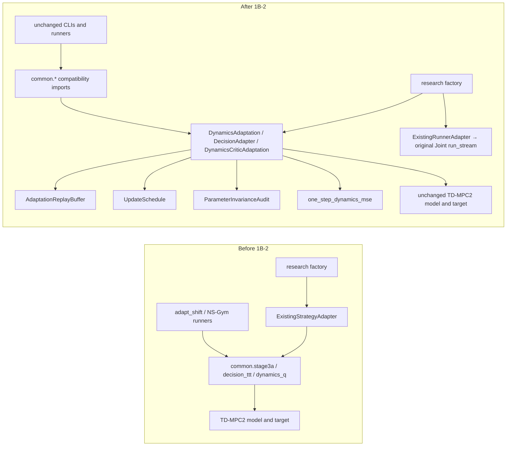
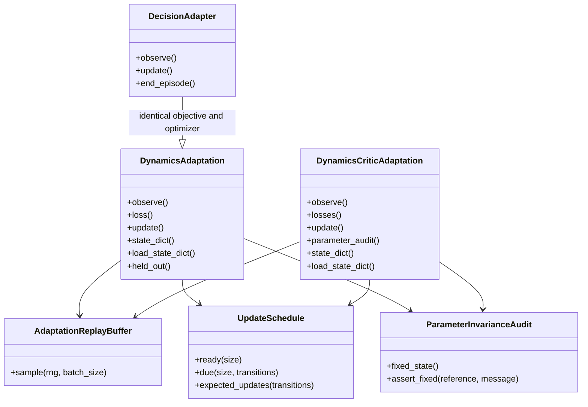

# Dynamics-shift research architecture — Phase 1B-2

The active inner project owns adaptation in `tdmpc2/research/dynamics_shift/`. The original TD-MPC2 agent, planner and training buffer are unchanged. Joint RL remains with its existing runner. NS-Gym and ManiSkill2 runtime imports remain separate.

```text
tdmpc2/research/dynamics_shift/
├── __init__.py          canonical exports
├── interfaces.py        method/config/state/strategy/runner contracts
├── factory.py           selection and runner composition
├── adapters.py          Joint and existing stream runner delegate
├── dynamics.py          DynamicsAdaptation, episode validation, native budget monitor
├── decision.py          DecisionAdapter (DynamicsAdaptation objective; decision schedule)
├── dynamics_critic.py   DynamicsCriticAdaptation (separate D/Q optimizers, target EMA)
├── replay.py            AdaptationReplayBuffer (bounded deque, original list sampler)
├── schedule.py          UpdateSchedule and original expected_updates formula
├── audit.py             ParameterInvarianceAudit and exact state comparison
└── objectives.py        shared one-step latent dynamics MSE expression
```

## Dependencies





| Original public path | Canonical owner | Compatibility |
|---|---|---|
| `common.stage3a.EpisodeAdapter` | `research.dynamics_shift.dynamics.DynamicsAdaptation` | Exact class alias; constructor and methods retained |
| `common.decision_ttt.DecisionAdapter` | `research.dynamics_shift.decision.DecisionAdapter` | Exact class alias; scheduler state retained |
| `common.dynamics_q.DynamicsQAdapter` | `research.dynamics_shift.dynamics_critic.DynamicsCriticAdaptation` | Exact class alias; D+Q update math retained |
| `common.dynamics_q.expected_updates` | `research.dynamics_shift.schedule.expected_updates` | Exact formula alias |
| `common.stage3a.equal_state / validate / NativeBudgetMonitor` | `research.dynamics_shift.audit / dynamics` | Imports preserved |
| Joint `run_full_joint_rl.run_stream` | Original NS-Gym runner | `ExistingRunnerAdapter` only; no algorithm move |

`compose_adaptation` now returns a canonical strategy directly for Frozen, Dynamics-only, Decision TTT and D+Q. It binds Joint to the caller-supplied original `run_stream`. Existing CLI constructors still import their old `common.*` names and receive the same class objects. The old modules are retained as thin import shims pending an external-caller audit in a later phase.

The original `common.buffer.Buffer` remains the Joint/TD-MPC2 training replay. The new adaptation replay subclass keeps the exact deque capacity and `random.Random.sample(list(replay), batch_size)` semantics; transition record schemas remain distinct. Schedules read the original mutable settings mapping at call time and are absent from serialized state, preserving legacy checkpoint keys and live configuration access. Audit snapshots preserve the episode adapter's CPU tensor clone policy and D+Q's deep-copy policy.

Only the original one-step dynamics MSE expression is shared numerically. D+Q categorical cross-entropy, actual-next-observation TD target, independent Adam steps, Q train/dropout mode, gradient isolation and target EMA remain in `DynamicsCriticAdaptation`. Native MPPI planning, evaluation runners, figures, historical results and the six upstream-modified TD-MPC2 core files remain unchanged.

The CPU and Linux golden fixtures retain their original source SHA-256 values. Golden tests compare every numerical and RNG field against those fixtures; the migrated source paths are checked as changed provenance separately, while unmigrated source hashes must match. No fixture is regenerated.
