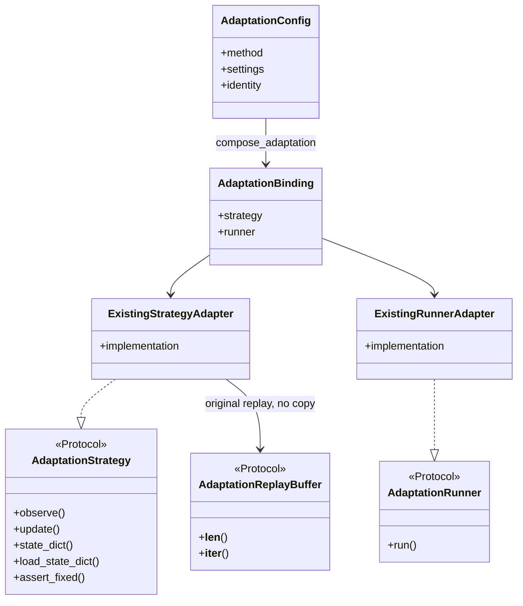

# Dynamics-shift research architecture — Phase 1B-1

The active package is `tdmpc2/research/dynamics_shift/` under the inner project root. This phase adds a composition boundary only. Existing CLI scripts, models, update implementations, replay storage, checkpoint writers and evaluators continue to own their behavior.

```text
tdmpc2/research/dynamics_shift/
├── __init__.py       public interface exports
├── interfaces.py     method type, raw config/state types and small protocols
├── adapters.py       transparent strategy and runner delegates
└── factory.py        method selection and dependency injection
```



`AdaptationState` is a type alias for the existing state mapping. No new checkpoint schema is created. `AdaptationConfig` holds references to the original settings and identity mappings; the factory passes them into existing constructors without default insertion, normalization or cloning. `ExistingStrategyAdapter` forwards calls and unknown attributes to the same production object. `ExistingRunnerAdapter` calls the supplied production runner with the original arguments. Joint training remains in its original `run_full_joint_rl.run_stream` function, supplied to the factory when Joint is selected.

| Canonical selection | Production implementation | Replay and RNG owner | Runner boundary |
|---|---|---|---|
| Frozen | `common.stage3a.EpisodeAdapter` with `mode=frozen` | Episode adapter's deque and `random.Random` | Existing Frozen stream function |
| Dynamics-only | `common.stage3a.EpisodeAdapter` with `mode=dynamics_only` | Same adapter, independently instantiated | Existing episode stream function |
| Decision TTT | `common.decision_ttt.DecisionAdapter` with `mode=decision_ttt` | Inherited deque and `random.Random` | Existing decision stream function |
| Dynamics+Q | `common.dynamics_q.DynamicsQAdapter` | D+Q adapter's deque and `random.Random` | Existing D+Q stream function |
| Joint | `run_full_joint_rl.run_stream` callable | Original TD-MPC2 `Buffer` and agent RNG inside runner | Callable delegate; no fabricated stepwise strategy |

The new package imports no simulator or script runner at module import time. Only a selected strategy imports its existing `common` implementation. NS-Gym runner callbacks are supplied by the NS-Gym caller; ManiSkill2 remains in its original environment path. This keeps the runtime dependency sets separate.

No six upstream-modified core files were changed in Phase 1B-1. Their proposed changes, if ever needed, require a separate documented review before implementation. No algorithm, public legacy constructor, import path or CLI was replaced.
