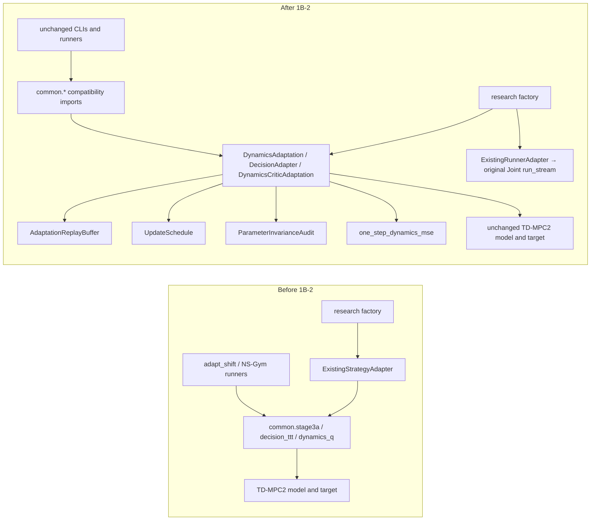
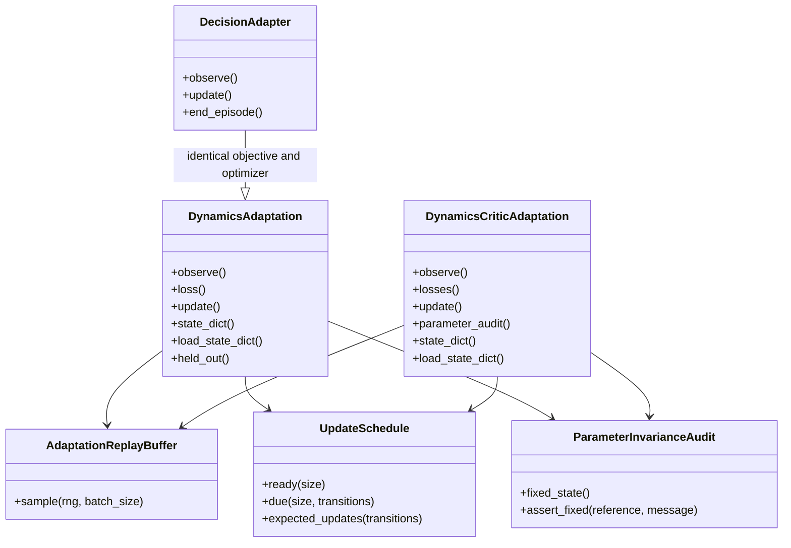
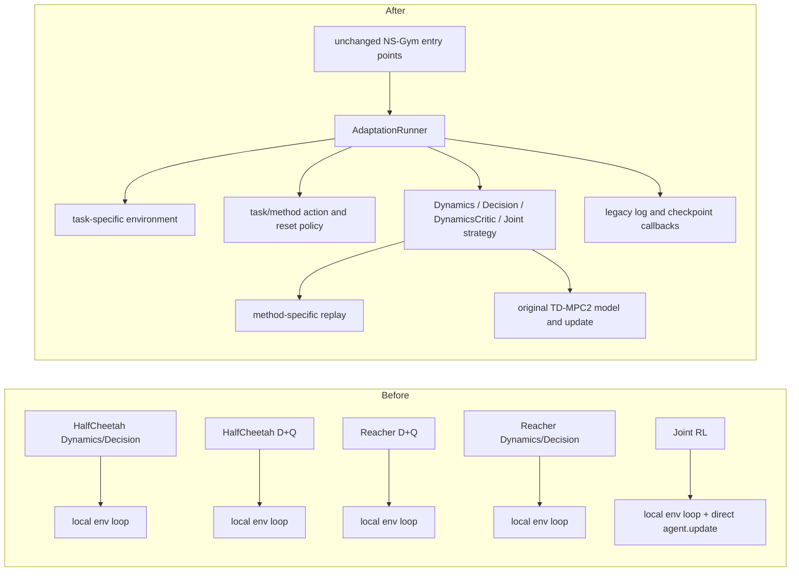
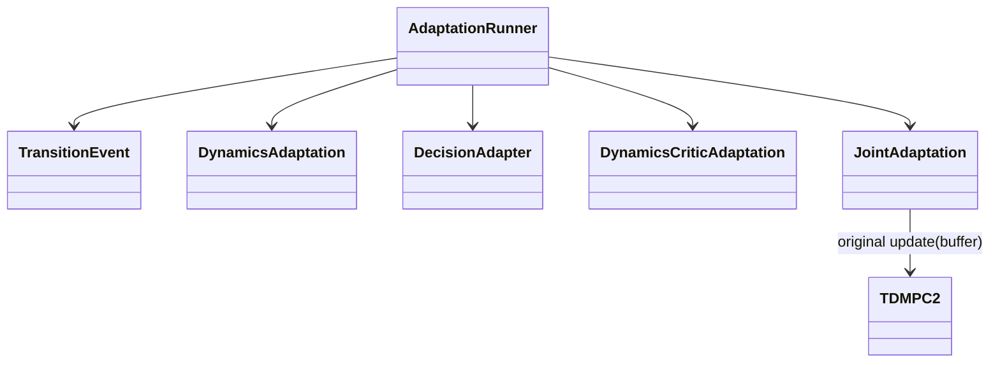
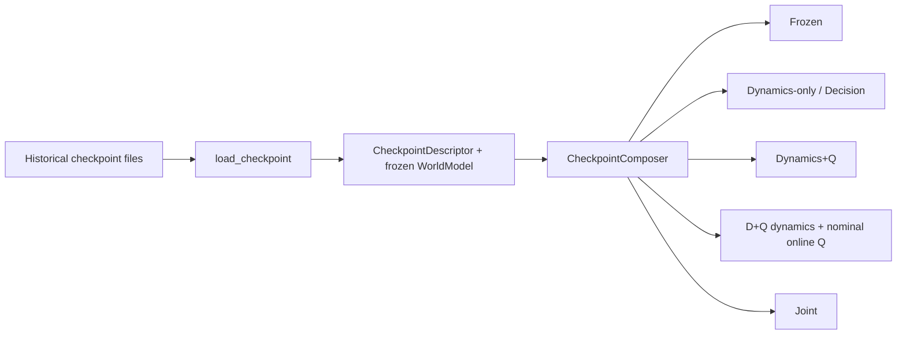
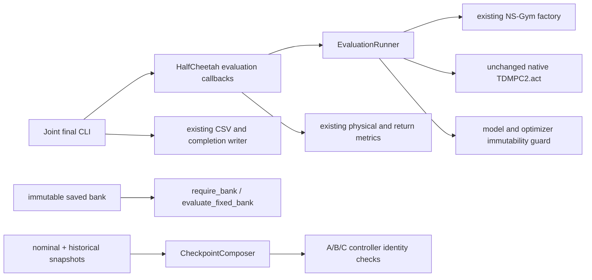
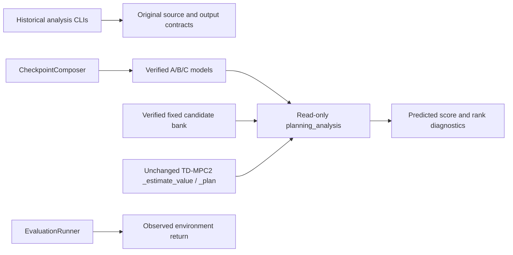
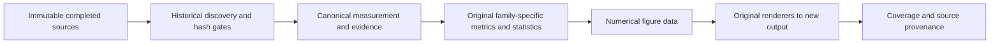

# Dynamics-shift research architecture — Phase 1B-3

Phase 4B final state: the canonical adaptation, checkpoint, evaluation, planning-analysis and reporting modules below remain the owners established in Phases 1–3. Phase 4B made no runtime-code deletion: active CLIs, historical `control_q` source modules, source-hash-sensitive helpers, `common.*` import aliases and the two path-specific script trees still have callers or provenance contracts. The deletion decisions and remaining simulator boundary are recorded in [REFACTOR_FINAL_REPORT.md](REFACTOR_FINAL_REPORT.md).

For Phase 4A utility and inspection ownership, including retained source-hash-sensitive tree digests and the shared `inspection_common.py` flow, see [CLEANUP_INVENTORY.md](CLEANUP_INVENTORY.md). The original training and control-Q `tree_hash` implementations remain in their original files because full evaluation compares implementation source hashes across smoke and full runs. Pusher and Reacher inspection keep their public CLIs and task-specific summaries; only shared seed/evaluation/CSV orchestration moved to `experiments/nsgym/scripts/inspection_common.py`.

The active inner project owns adaptation in `tdmpc2/research/dynamics_shift/`. The original TD-MPC2 agent, planner and training buffer are unchanged. Joint learning is invoked through `JointAdaptation`, which calls the original `TDMPC2.update(replay)`. NS-Gym and ManiSkill2 runtime imports remain separate.

```text
tdmpc2/research/dynamics_shift/
├── __init__.py          canonical exports
├── interfaces.py        method/config/state/strategy/runner contracts
├── factory.py           selection and runner composition
├── adapters.py          historical full-stream callable delegate
├── runner.py            environment/transition/budget/log/checkpoint event loop
├── joint.py             original TD-MPC2 update delegation and Joint cadence
├── provenance.py        audited pre/post runner source identities
├── dynamics.py          DynamicsAdaptation, episode validation, native budget monitor
├── decision.py          DecisionAdapter (DynamicsAdaptation objective; decision schedule)
├── dynamics_critic.py   DynamicsCriticAdaptation (separate D/Q optimizers, target EMA)
├── replay.py            AdaptationReplayBuffer (bounded deque, original list sampler)
├── schedule.py          UpdateSchedule and original expected_updates formula
├── audit.py             ParameterInvarianceAudit and exact state comparison
└── objectives.py        shared one-step latent dynamics MSE expression
```

## Dependencies





| Original public path | Canonical owner | Compatibility |
|---|---|---|
| `common.stage3a.EpisodeAdapter` | `research.dynamics_shift.dynamics.DynamicsAdaptation` | Exact class alias; constructor and methods retained |
| `common.decision_ttt.DecisionAdapter` | `research.dynamics_shift.decision.DecisionAdapter` | Exact class alias; scheduler state retained |
| `common.dynamics_q.DynamicsQAdapter` | `research.dynamics_shift.dynamics_critic.DynamicsCriticAdaptation` | Exact class alias; D+Q update math retained |
| `common.dynamics_q.expected_updates` | `research.dynamics_shift.schedule.expected_updates` | Exact formula alias |
| `common.stage3a.equal_state / validate / NativeBudgetMonitor` | `research.dynamics_shift.audit / dynamics` | Imports preserved |
| Joint `run_full_joint_rl.run_stream` | Original NS-Gym runner | `ExistingRunnerAdapter` only; no algorithm move |

`compose_adaptation` now returns a canonical strategy directly for Frozen, Dynamics-only, Decision TTT and D+Q. It binds Joint to the caller-supplied original `run_stream`. Existing CLI constructors still import their old `common.*` names and receive the same class objects. The old modules are retained as thin import shims pending an external-caller audit in a later phase.

The original `common.buffer.Buffer` remains the Joint/TD-MPC2 training replay. The new adaptation replay subclass keeps the exact deque capacity and `random.Random.sample(list(replay), batch_size)` semantics; transition record schemas remain distinct. Schedules read the original mutable settings mapping at call time and are absent from serialized state, preserving legacy checkpoint keys and live configuration access. Audit snapshots preserve the episode adapter's CPU tensor clone policy and D+Q's deep-copy policy.

Only the original one-step dynamics MSE expression is shared numerically. D+Q categorical cross-entropy, actual-next-observation TD target, independent Adam steps, Q train/dropout mode, gradient isolation and target EMA remain in `DynamicsCriticAdaptation`. Native MPPI planning, evaluation runners, figures, historical results and the six upstream-modified TD-MPC2 core files remain unchanged.

The CPU and Linux golden fixtures retain their original source SHA-256 values. Golden tests compare every numerical and RNG field against those fixtures; the migrated source paths are checked as changed provenance separately, while unmigrated source hashes must match. No fixture is regenerated.

## Phase 1B-3 runner composition



The canonical `AdaptationRunner` owns reset, action, real `env.step`, transition delivery, horizon/budget indices and optional logging/checkpoint callbacks. `iter_steps()` yields after strategy observation and before the next reset, preserving legacy artifact timing. `run()` can close on error; production call sites retain their existing `finally` blocks so final validation precedes environment close. The canonical package imports neither NS-Gym nor ManiSkill2.



| Existing entry point | Canonical loop/strategy | Legacy responsibility retained |
|---|---|---|
| `run_dynamics_only_ttt.rollout` | `iter_steps` + Dynamics/Decision | physical diagnostics, CSV/NPZ/snapshot schema |
| `run_dynamics_q.train_one` | `run` + DynamicsCritic | HalfCheetah metrics and snapshot schema |
| `run_reacher_dynamics_q.train_one` | `run` + DynamicsCritic | Reacher metrics and selection gate |
| `reacher_pipeline.adapt_one` | `iter_steps` + Dynamics/Decision | Reacher snapshot/reload checks |
| `run_full_joint_rl.run_stream` | `run` + JointAdaptation | original `Buffer`, manifests, completion, evaluation |
| `common.stage3b.run`, `adapt_shift.episode` | unchanged | ManiSkill2 native-step resume and simulator state |

New artifacts record current source hashes. `provenance.compatible_sources` accepts a pre-migration runner hash only when the corresponding current runner file matches its audited post-migration hash. All model, environment and configuration hashes remain exact. Historical manifests are never rewritten; older unlisted runner hashes require separate audit. The factory now binds `JointAdaptation` when supplied the original agent, replay and settings; `ExistingRunnerAdapter` remains a compatibility delegate for callers supplying only a complete historical `run_stream` callable. Native MPPI, evaluation runners, historical results and figures are unchanged.

## Phase 2A checkpoint boundary

`checkpoints.py` owns read-only nominal/Decision/D+Q/Joint format recognition, source identity, strict `WorldModel` restoration and component descriptors. `composer.py` owns only in-memory controller construction and component isolation. It neither replaces the existing CUDA `training_support.load_checkpoint` agent loader nor changes any production evaluation entry point. The historical format matrix, examples and online-versus-target Q distinction are in [CHECKPOINT_FORMATS.md](CHECKPOINT_FORMATS.md).



## Phase 2B evaluation boundary

`evaluation.py` defines `EvaluationConfig`, `EvaluationCallbacks`, `EvaluationStep`, `EpisodeResult`, `EvaluationIdentity` and `EvaluationRunner`. The runner owns one seed/environment/reset/action/step/record/verification/close sequence. The caller binds the original task-specific environment, native `TDMPC2.act`, physical readback, metrics and output writer. It does not import either simulator stack. The first migrated production path is HalfCheetah Joint final control in `experiments/nsgym/scripts/evaluate_joint_final.py`; its prediction, CSV and completion code remain in the existing CLI.



Frozen, Dynamics-only, D+Q, Reacher and control-Q historical CLI paths still own their distinct episode loops or `ttt.rollout` calls; their source-hash contracts need audited parity before migration. ManiSkill2 `evaluate.py`, `evaluate_shift.py` and `evaluate_severity.py` retain native-step/action-repeat behavior in the separate runtime. The complete protocol matrix, planner RNG policy, bank and intervention contracts are in [EVALUATION_PROTOCOLS.md](EVALUATION_PROTOCOLS.md). Phase 2B migration is partial and does not assert ManiSkill2 simulator parity.

## Phase 3A planning analysis

`planning_analysis.py` is the read-only canonical entry point for fixed candidate scoring, latent error, terminal-Q attribution, ranking policies, Q-swap score isolation and native trace verification. Fixed scoring invokes the unchanged `TDMPC2._estimate_value`; native MPPI traces still originate from the unchanged `TDMPC2._plan`. `CheckpointComposer` supplies verified A/B/C model identities, while `EvaluationRunner` owns only actual environment control. The old NS-Gym and ManiSkill2 analysis entry points remain in place for historical source and output compatibility. [PLANNING_ANALYSIS.md](PLANNING_ANALYSIS.md) records the source ownership matrix, tensor shapes, stochastic planner path and unmeasured quantities.


## Phase 3B reporting boundary

The read-only `research.dynamics_shift.reporting` package now owns explicit source roots, canonical evidence labels, statistical dispatch, numerical figure inputs and report assembly. It calls the unchanged NS-Gym unified and control-Q calculations and renderers. See [REPORTING_PIPELINE.md](REPORTING_PIPELINE.md) for the source-to-output matrix, distinct bootstrap policies, 36-condition/108-stream control-Q contract and `NOT_MEASURED` rule. Legacy CLIs retain their current import paths and schemas; TD-MPC2 model, adaptation, evaluation and native planner code are outside this reporting layer.


