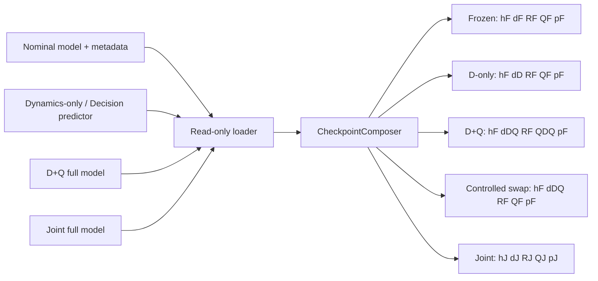

# Historical checkpoint loading and composition — Phase 2A

`research.dynamics_shift.checkpoints.load_checkpoint()` reads the nominal checkpoint and optionally one adaptation snapshot into the original `WorldModel` architecture on CPU. It uses TD-MPC2's `api_model_conversion` followed by an exact key/shape check and `strict=True` model load. Model initialization runs inside a CPU RNG fork. No simulator, training agent, optimizer step or environment is created. Source files are read only. The descriptor records source and parent SHA-256, model configuration identity, task, observation/action/latent dimensions, adaptation identity and configuration, available source hashes, transition count, optimizer key names, resume marker, and full/component state hashes. Missing historical metadata is represented by `None`.

| Format | Historical files | Model restoration | Optimizer storage | Nominal parent |
|---|---|---|---|---|
| Nominal | `model.pt`, `optimizers.pt`, `metadata.json` | Full `model` state | Separate `optimizers.pt`: `optim`, `pi_optim`, `scale` | Metadata `model_sha256`; both file hashes checked |
| Dynamics-only / Decision | `snapshot-*.pt` | Nominal model plus `adapter.predictor` into `_dynamics` | `adapter.optimizer` | HalfCheetah `checkpoint_sha256`; Reacher `selection.model_sha256` and selected configuration |
| Dynamics+Q | `snapshot-*.pt` | Full `model` state | `adapter.dynamics_optimizer`, `adapter.q_optimizer` | HalfCheetah `checkpoint_sha256` plus `checkpoint_config`; Reacher `selection.model_sha256` and selected configuration |
| Joint | `snapshot-*.pt` | Full `model` state | `optim`, `pi_optim`, `scale` in snapshot | `checkpoint_sha256`; saved configuration must match nominal |
| Controlled Q swap | No historical checkpoint of its own | Fresh copy of D+Q with nominal online Q | None; inference only | Both verified D+Q and nominal sources |

Historical control-Q analysis also builds `WorldModel` with `api_model_conversion` and `strict=True`. Its D snapshot applies the predictor to a nominal model; its D+Q and Joint snapshots supply full model states. The Phase 2A loader preserves these contracts and leaves existing analysis entry points unchanged. The current control-Q Q swap is an in-memory diagnostic, not a saved checkpoint format.



`_Qs.params` is the **online critic** used by native planning. `_detach_Qs_params` is its registered detach alias. `_target_Qs_params` is the separately stored target critic used for training targets; the `_target_Qs` wrapper itself has no state dictionary entries. `CheckpointComposer.controlled_q_swap()` deep-copies the D+Q model, loads only nominal `_Qs` parameters, then verifies that only online-Q and detach-alias state keys differ. Encoder, dynamics, reward, actor, normalization buffers and target-Q stay byte-identical to D+Q. It also verifies the nominal and adapted source models did not change. The swap requires the same nominal parent, task, full model configuration, observation and action dimensions, latent dimension, and fixed encoder/reward/actor hashes. Joint coordinates are never cross-swapped with nominal Q.

```python
from research.dynamics_shift import CheckpointComposer, load_checkpoint

nominal = load_checkpoint(nominal_directory, expected_task="nsgym-halfcheetah")
composer = CheckpointComposer(nominal)
frozen = composer.compose("frozen")
d_only = composer.compose("dynamics_only", load_checkpoint(nominal_directory, d_path))
dq_source = load_checkpoint(nominal_directory, dq_path)
dq = composer.compose("dynamics_q", dq_source)
controlled = composer.compose("controlled_q_swap", dq_source)
joint = composer.compose("joint", load_checkpoint(nominal_directory, joint_path))
```

The loader checks nominal metadata file hashes and the snapshot's declared parent; callers can require an exact snapshot hash through `expected_sha256`. Existing manifests and source-hash inventories remain authoritative for run-level provenance and are not rewritten here. Full model and component hashes cover the reconstructed model; a Dynamics-only snapshot contains only the predictor and therefore depends on its verified nominal parent.

All composed models are independent, frozen and in evaluation mode. They do not contain usable training replay, environment state or global RNG state. Historical Joint and stream snapshots cannot claim exact training continuation. Shared-input rollout checks establish prediction equality for D+Q and its controlled swap; differing Q values or candidate scores do not establish control benefit. The actual closed-loop Q-swap experiment is outside Phase 2A.
