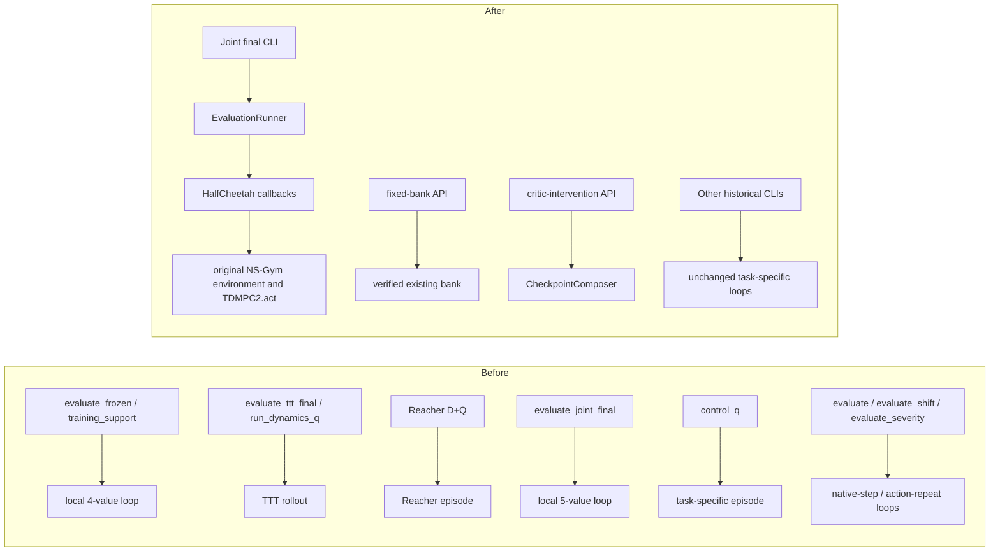

# Evaluation protocols — Phase 2B

## Scope and status

The canonical `EvaluationRunner` owns one seeded episode's reset, action, step, stop, step callback, completion record, verification callback and environment close. `EvaluationCallbacks` binds task-specific behavior without importing NS-Gym or ManiSkill2 into the research package. `EvaluationConfig` makes seed, horizon and boundary stopping explicit. The runner does not reseed between actions, choose the planner's `eval_mode`, change `_prev_mean`, update an optimizer, touch replay or interpret a result.

The first production binding is HalfCheetah Joint final control in `evaluate_joint_final.evaluate_one`. The remaining historical evaluators are retained because their source hashes, native-step protocols and result schemas differ. This phase is **PARTIAL** until the NS-Gym bindings and a separate compatible ManiSkill2/SAPIEN validation are complete. A passing NS-Gym test does not establish ManiSkill2 parity.

## Evaluation-path audit

| Path | Environment, seed and initial state | Planner, horizon and boundaries | Metrics, output and identity | Phase 2B ownership |
|---|---|---|---|---|
| `evaluate_frozen.py` → `training_support.evaluate` | `make_env` per seed, `set_seed` before construction, `env.reset(seed)`; configured nominal/fixed mass; restores Python/NumPy/Torch CPU/CUDA RNG and `_prev_mean` after sweep | Native `agent.act(..., eval_mode=True)`, 4-value NS-Gym wrapper, configured episode length; `info.terminated/truncated` | HalfCheetah/Pusher/Reacher reward, control, velocity/goal and mass readback; JSONL/CSV/integrity; source hashes and optimizer/model guard | Legacy loop retained; `training_support.py` is recorded in historical source manifests |
| `evaluate_ttt_final.py` | `ttt.seeded(seed)` before `ttt.environment`; real reset inside `ttt.rollout` | `eval_mode=True`, 1000-step HalfCheetah rollout, `truncated=True` required | Frozen-paired control and nominal retention CSV; prediction reads SHA-verified frozen NPZ; adapter held-out and model/aux guards | Legacy loop retained; source recorded by D+Q manifests |
| `evaluate_joint_final.py` | `ttt.seeded(seed)`, fixed HalfCheetah environment, explicit reset | Native stochastic MPPI with `eval_mode=True`, `t0` at step zero; 1000 steps or 24-step smoke, five-return Gymnasium API | Velocity/control/force/readback and paired frozen values, unchanged model+optimizers+scale, legacy CSV/completion | **Control episode migrated** to `EvaluationRunner`; prediction and batch/output logic retained |
| `run_dynamics_q.py` | `ttt.environment` and frozen seed bank; `ttt.rollout` for control/nominal | Same HalfCheetah 1000-step semantics, adapter held-out | Per-stream CSV, manifest, source hashes and completion; prediction latent MSE in 256-row chunks | Legacy evaluator retained; source-hash compatibility needs separate audit before editing |
| `run_reacher_dynamics_q.py` / `reacher_pipeline.py` | `SeverityReacher`, 50-step reset, explicit held-out seeds; Reacher bank shape `(51,10)/(50,2)` | Reacher task action and `eval_mode=True`; 50-step truncation | Reacher distance/reward, selected checkpoint, family/severity readback, per-stream CSV | Legacy evaluator retained; distinct task and source hash contract |
| `control_q/evaluation.py` | HalfCheetah or Reacher physical episode; same integer seed is insufficient to prove same initial state | Historical native MPPI, no action tape; task-specific episode loops | D+Q vs Q-swapped trajectory files and isolation/source manifests | Canonical A/B/C controller construction available; full study **not run** |
| `tdmpc2/evaluate.py` | `make_env`, optional shift wrapper and per-episode seed; multi-task reset differs | Original `agent.act` default mode, 4-return API; native action repeats and success | `EvaluationLog`, video, task return/success, native-step fields | ManiSkill2 legacy path retained |
| `tdmpc2/evaluate_shift.py` | `set_seed` before each reset, initial simulator state and shift schedule capture | Configured `policy_eval_mode` (default false), native-step events, action repeats | `BenchmarkLog`, physical events, pairing traces, environment captures, completion | ManiSkill2 legacy path retained |
| `tdmpc2/evaluate_severity.py` | Strict Stage 3B seed grid and output path; independent nominal/shifted setup | `eval_mode=True`, native action repeats via `adapt_shift.episode` | Physical readback, measured EEF, per-condition files and atomic completion | ManiSkill2 legacy path retained |

The old CLI arguments, seed splits, file names, missingness, completion status and source-hash rules remain authoritative. No historical artifact is rewritten. Existing simulator factories remain separate, and no module eagerly imports both stacks.

## API and invariants

`EvaluationRunner.run(EvaluationConfig, EvaluationProtocol)` executes `seed → create_environment → reset → [action → step → record_step] → verify_unchanged → close`. `EvaluationStep` preserves original observation, commanded action, actual next observation, reward, independent termination and truncation flags, and raw info. The task binding specifies whether to stop at either boundary. A separate action callback invokes the **unchanged** `TDMPC2.act`; `eval_mode=True` does not make native MPPI deterministic. The Joint binding preserves one seed call before environment creation, `t0` only on the first action, original force/readback calculations, no-grad context and row schema. A model/optimizer guard runs before its episode completes, and the original post-loop guard remains.

`EvaluationIdentity` can record protocol kind, task, checkpoint hash, evaluation seed, measured initial-state hash and RNG hash. These optional values must be measured by a task binding before making a paired counterfactual claim. Equal integer seeds alone do not establish identical initial simulator states or planner noise. No new claim of exact A/B/C trajectory pairing is made.

`require_bank` verifies that a saved bank exists and has the declared SHA-256. `aligned_transitions` uses observation row `i+1` as the real target for action row `i`. `evaluate_fixed_bank` checks rows and optional termination/truncation boundaries, scores explicit batches, reports sample count and mean error, and rechecks the source hash. It never calls a simulator or generates a bank. Batch size is explicit because floating summation and model batch behavior can affect numerical parity; legacy 256-row HalfCheetah and one-row Reacher definitions remain at their existing call sites until method-specific parity is executed.

`critic_intervention_controllers` uses the Phase 2A composer to create A = Dynamics-only (`hF,dD,RF,QF,pF`), B = D+Q dynamics with nominal online Q (`hF,dDQ,RF,QF,pF`), and C = full D+Q (`hF,dDQ,RF,QDQ,pF`). It checks B/C non-Q identity and frozen model state. It does not run trajectories or imply that B is a Q-only adaptation. The existing `control_q` evaluator remains the production study path; no full Q-swap experiment runs in Phase 2B.

## Compatibility and remaining gates

Historical snapshots remain evaluation-only where replay, environment and RNG are absent. The Phase 2A checkpoint loader/composer and original TD-MPC2 model, optimizer, planner and adaptation update code are unchanged. Legacy NS-Gym evaluators with source hashes require an audited provenance bridge and direct numerical parity before migration. ManiSkill2 evaluation requires its separate compatible simulator runtime. A future planning/reporting phase must not infer parity from these infrastructure contracts.
