# Phase 3A planning analysis

## Status and numerical ownership

Phase 3A adds read-only analysis in `research.dynamics_shift.planning_analysis`. The original `TDMPC2._plan`, `TDMPC2._estimate_value`, `WorldModel.Q`, categorical decoder, adaptation code, evaluation runner and historical source files are unchanged. The canonical fixed-bank entry point calls native `_estimate_value` on caller-supplied actions and observes its actual computations. `native_trace_diagnostics` checks the native observer rows produced by an unchanged `_plan` call; it does not generate proposals or choose an action. Existing CLI/report entry points retain their source hashes and output schemas until a separate provenance bridge can be validated.

| Source | Current scientific calculation | Phase 3A owner / treatment |
|---|---|---|
| `tdmpc2/tdmpc2.py` + `common/world_model.py` | Policy-prior and Gaussian proposals; latent transitions; two-hot reward/Q decoding; random online-Q pair; elite/MPPI update; stochastic final choice | **Native authority**. New code calls these methods and observes outputs; no production edit. |
| `common/planner_trace.py` | Passive native planner candidate/score/elite/action capture | Retained; native trace contract documented. |
| `common/mechanism_analysis.py` | Replay-command open-loop rollout, one-step latent error, immediate online Q and diagnostic Bellman proxy | `latent_prediction_diagnostics` reproduces its error units; historical writer and proxy remain intact. |
| `common/mechanism_metrics.py` | Midrank and missingness-aware descriptive ranking | `candidate_rank_comparison(policy="mechanism")` uses this implementation directly. |
| `experiments/nsgym/scripts/q_planning_core.py` | Exogenous candidate generation, categorical Q distributions, native fixed-candidate score, legacy ranking | `score_fixed_candidates` is the future fixed-bank interface; it calls native scoring. Historical source remains intact. Candidate generator and Q distribution outputs retain their original code. |
| `analyze_q_planning.py` | Historical source discovery, inference/aggregation/report/packaging | Retained CLI and output authority; report renderer is outside Phase 3A. |
| `mechanism_forward.py` | Saved-transition Q/reward/latent and transplanted-action score analysis | Retained; its mean-head terminal value is a distinct scientific quantity. |
| `control_q/diagnostics/terminal_value.py` + `control_q/metrics.py` | Verified bank selection, F→D→DQ_F→DQ attribution, aggregation, missingness | `terminal_value_decomposition` preserves the additive formula and tolerance. Historical tables remain unchanged. |
| `control_q/diagnostics/planning.py` | `RandomTape`, instrumented native `_plan`, shared-proposal rescore, per-state metrics | Existing validated native trace remains source of proposal/terminal-action/head evidence; `native_trace_diagnostics` checks its elite, weights, Gaussian and action fields. |
| `control_q/diagnostics/q_swap.py` | In-memory online-Q-only copy | Retained for historical analysis; `CheckpointComposer` is the canonical verified A/B/C source. `controlled_q_score_difference` verifies B/C component and candidate identity before attribution. |
| `research/dynamics_shift/evaluation.py` | Actual environment episode orchestration | Used only for real control evaluation, never for model-only planning analysis. |

## Data flow and tensor contracts

```mermaid
flowchart LR
  O[observation B x obs_dim] --> E[WorldModel.encode]
  E --> Z[encoded latent B x latent_dim]
  Z --> P[original TDMPC2._plan]
  P --> PRIOR[policy-prior actions H x P x action_dim]
  P --> GAUSS[Gaussian actions H x N-P x action_dim]
  PRIOR --> C[candidates H x N x action_dim]
  GAUSS --> C
  C --> V[original _estimate_value]
  V --> R[predicted discounted reward N x 1]
  V --> T[predicted terminal online Q N x 1]
  R --> S[total predicted score N x 1]
  T --> S
  S --> ELITE[top-k elite indices and weights]
  ELITE --> M[MPPI mean and std H x action_dim]
  M --> A[stochastic native selected action]
  A --> ENV[environment return: separate EvaluationRunner]
```

The fixed-candidate interface expects a single observation of shape `(obs_dim,)` and caller-supplied actions of shape `(H,N,action_dim)`. It returns encoded and rolled latent tensors `(N,latent_dim)`, reward logits per step `(N,num_bins)`, terminal logits `(num_q,N,num_bins)`, the sampled two online-Q head indices, `(N,1)` reward and discounted terminal contributions, `(N,)` total scores, elite indices and softmax weights. `candidate_sha256` includes dtype, shape and raw tensor bytes; an expected hash can be required. The interface never generates a substitute bank.

`_estimate_value` accumulates each decoded predicted reward with the native discount recurrence. It calls `model.next` after every reward, then samples a terminal policy action and two online-Q heads through `WorldModel.Q(return_type="avg")`. The terminal contribution is the discounted decoded average of those heads. `reward_sum + terminal_contribution = total_score` is asserted exactly for the captured native tensors. The extra all-head terminal logits are a read-only diagnostic; they are **not** the target critic or a training TD target. The fixed candidate rank and softmax weight are descriptive; this API does not produce the native selected action.

Native MPPI additionally samples a learned policy prior, Gaussian proposals, a random Q pair at each value estimate and a Gumbel-weighted final elite. `eval_mode=True` only suppresses the final action perturbation; it does not make candidate generation, terminal actions, Q heads or final elite choice deterministic. Warm start shifts the previous mean by one planning step. `native_trace_diagnostics` validates the original `_plan` trace's candidate split, score sum, top-k indices, exponential weights, mean/std and selected action without consuming RNG. The existing `RandomTape` in control-Q analysis is used where exact shared draws are required.

## Q quantities and intervention identity

| Quantity | Input latent/action | Critic | Meaning |
|---|---|---|---|
| Immediate Q | Encoded **real observation** and recorded or proposed first action | Online `_Qs`; all heads may be decoded | A model estimate at the current state; neither a TD target nor observed return. |
| Terminal Q | **Imagined** latent after H model transitions and sampled policy action | Two sampled online Q heads in native `avg`; fixed diagnostics may report all heads separately | Discounted bootstrap contribution to a predicted candidate score. |
| Total score | Same candidate trajectory | Reward model plus terminal Q | Predicted ranking input to MPPI. |
| Selected action | Native stochastic MPPI proposals and Gumbel choice | Native model | Action issued to the environment; not an actual return. |
| Actual return | Executed environment trajectory | No Q model | Observed reward sum, recorded only by evaluation paths. |

`CheckpointComposer` defines A = Dynamics-only predictor + frozen online Q, B = D+Q predictor + frozen online Q, C = D+Q predictor + adapted online Q. B versus C is an **online-Q-only** intervention: encoder, dynamics, reward, target Q, actor and normalization hashes must match. The same candidate bank, encoded latent, terminal latent, terminal action, reward sum and sampled Q-head indices must also match before `controlled_q_score_difference` attributes score changes to terminal Q. A versus C changes separately adapted predictors and is not an isolated critic effect. A score/rank change does not prove improved physical return or critic accuracy. Q magnitude, entropy and head disagreement alone do not measure Q accuracy.

The F→D→DQ_F→DQ terminal decomposition preserves control-Q's original `float64` conversion and `rtol=1e-10, atol=1e-8` additive check. The `control_q` ranking policy retains its original tie handling, top-k overlap denominator and nonfinite rejection. The mechanism ranking policy retains midranks, boundary ties and `UNVERIFIED_NONFINITE_OR_EMPTY` missingness. They are separate named policies because merging them would change historical tables.

## Compatibility and validation boundary

The historical NS-Gym CLI scripts, ManiSkill2 mechanism writer, control-Q source manifests and figures remain untouched. New analysis has no simulator, optimizer or checkpoint writer. Historical snapshot and bank loading continues through the Phase 2A `CheckpointComposer` and Phase 2B bank checks; missing sources and incompatible task/configuration fail there. The new numerical tests compare canonical fixed-bank tensors against `q_planning_core.score` at zero tolerance, the additive/rank/latent formulas against their legacy functions, and a real `WorldModel` native trace against its observer. They also check candidate hash, model state, RNG restoration and invalid inputs. CUDA and separate ManiSkill2 simulator validation are independent gates; no physical trajectory or full Q-swap experiment is generated in Phase 3A.
