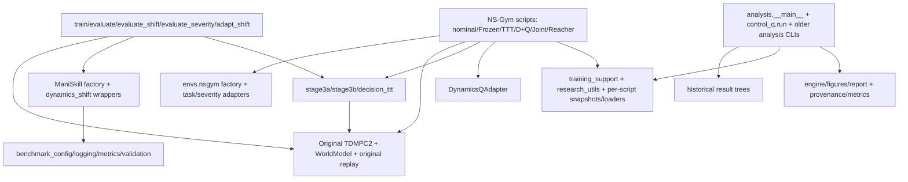

# TD-MPC2 dynamics-shift research refactor: Phase 0 migration plan

Audit basis: `4659c66` (2026-11-19, Asia/Seoul). Public-code comparison: `332f19e`. This document is the sole Phase 0 repository addition. Existing source, result and archive files were not edited. Historical PASS claims are inventory evidence, not validation of future code.

## Scope and invariants

- Keep original `TDMPC2`, `WorldModel`, optimizer targets, replay sampling, MPC, action-repeat, termination/truncation, discount and training update schedule numerically unchanged.
- Keep Dynamics+Q transition record, warmup, 25-decision update cadence, 118 dynamics and 118 Q updates per 3,000-transition stream, detached real latents, original categorical Q target/loss, two fresh Adam optimizers, and target-Q EMA. Treat these as explicit compatibility contracts, not generic strategy defaults.
- Keep all historical checkpoint/snapshot/config/CSV/JSON/NPZ layouts readable. Never rewrite existing results or figures in place. New artifacts use new output directories and retain source hashes and schema/version provenance.
- Preserve public CLI arguments and script paths as thin compatibility entry points until usage and downstream imports are audited. Do not consolidate experimental methods merely because they share file IO.

## A. Current architecture and dependency graph

Primary executable checkout is `tdmpc2/` below the outer repository. Outer `scripts/` is an exact mirror of inner `tdmpc2/scripts/`; outer `experiments/nsgym/` contains a partial earlier mirror. `tests/` at the outer root is empty at this HEAD. The public README and original TD-MPC2 training scripts remain; NS-Gym is an explicit separate factory.

Dependency boundary: original `docker/environment.yaml` pins PyTorch 2.7.1, Gymnasium 0.29.1, MuJoCo 3.1.2, NumPy 1.24.4, TensorDict 0.8.3 and TorchRL 0.8.1; the separate `experiments/nsgym/requirements*.txt` path pins NS-Gym commit `127df4b`, Gymnasium 1.3.0, MuJoCo 3.3.7, NumPy 2.4.6, PyTorch 2.14.0, TensorDict 0.14.3 and TorchRL 0.14.1. The legacy ManiSkill2/SAPIEN/gym boundary and NS-Gym/Gymnasium boundary must remain distinct. `analysis.__main__` imports source adapters and lazy-loads legacy formats; `control_q.run` reads three validated archive directories; `control_q.evaluation` loads CUDA models and simulators. Avoid moving heavy dependencies into read-only imports.

Active entry points: `tdmpc2/tdmpc2/{train,evaluate,evaluate_shift,evaluate_severity,adapt_shift}.py`; `tdmpc2/scripts/{evaluate_shift_suite,evaluate_mechanism_suite,run_stage3b,run_stage3b2,calibrate_physical_severity,...}.py`; `tdmpc2/experiments/nsgym/scripts/{train_nominal,evaluate_frozen,run_dynamics_only_ttt,evaluate_ttt_final,run_dynamics_q,run_reacher_dynamics_q,run_full_joint_rl,evaluate_joint_final,run_reacher_pipeline,analyze_q_planning}.py`; `python -m experiments.nsgym.analysis`; `python -m experiments.nsgym.analysis.control_q.run`; and separate `control_q.evaluation` for real Q-swap control. `...` here means auxiliary audit/probe/report CLIs, not hidden runtime entry points. Preserve their import/CLI contracts during migration.

Complete guarded `__main__` inventory (excluding tests and the three public task-module debug blocks): inner `scripts/`: `analyze_mechanism_artifacts`, `analyze_pairing_archive`, `analyze_physical_response`, `analyze_stage3a_matched`, `analyze_stage3b`, `analyze_stage3b2`, `analyze_stage3b_severity`, `audit_shift_logs`, `audit_shift_simulator`, `calibrate_physical_severity`, `evaluate_mechanism_suite`, `evaluate_shift_suite`, `probe_physical_response`, `run_stage3b`, `run_stage3b2`, `validate_pairing`, `validate_pairing_matrix`, `validate_shift_benchmark`. NS-Gym `scripts/`: `analyze_existing_mechanisms`, `analyze_q_planning`, `audit_nominal_convergence`, `evaluate_frozen`, `evaluate_joint_final`, `evaluate_ttt_final`, `inspect_pusher`, `inspect_reacher`, `plot_results`, `print_severity_commands`, `run_dynamics_only_ttt`, `run_dynamics_q`, `run_full_joint_rl`, `run_reacher_dynamics_q`, `run_reacher_pipeline`, `run_severity`, `smoke`, `train_nominal`, `validate_physics`. Analysis: `analysis.__main__`, `control_q.run`, `control_q.evaluation`. Shell/cluster launchers also include `evaluate_dynamics_shift.sh`, `launch_full_joint_rl.sh`, `run_pusher.sbatch`, `run_reacher.sbatch`. Modules without a guard may still be imported by these entry points and are covered by the migration map.

Public core changed in exactly six copied files relative to `332f19e`: `common/layers.py` (meta ensemble template and dropout mode), `envs/__init__.py` (shift routing), `envs/maniskill.py` (legacy Gym/shift/action-repeat/restore), `envs/wrappers/tensor.py` (seed forwarding), `evaluate.py` (shift logging), and `tdmpc2.py` (planner instrumentation). `common/world_model.py`, replay `common/buffer.py`, `train.py` and trainer files match the public baseline byte-for-byte in the inner checkout.

## B. Proposed canonical package and responsibility boundaries

Create `tdmpc2/research/` inside the executable checkout. Keep `tdmpc2/tdmpc2/` as the algorithm and environment adapter layer. Do not make classes for hashing, seed validation, statistics, file parsing, physics readback or figure calculations when pure functions suffice.

| Component | Owns | Must not own |
|---|---|---|
| `EnvironmentFactory` | Explicit selection of legacy ManiSkill and NS-Gym factories; task adapter construction; seed/reset and observation/action contract validation | TD-MPC2 planning or physics schedule math |
| `AdaptationStrategy` | Narrow protocol for `observe`, scheduled `update`, fixed-parameter audit, `state_dict`; concrete Frozen, DynamicsOnly, DecisionTTT, DynamicsQ and Joint adapters | Cross-stream scheduling or generic reinterpretation of D+Q targets |
| `AdaptationRunner` | One stream's transitions, episode boundaries, method-specific budgets, resume state, logging and strategy orchestration | Optimizer loss definitions or result aggregation |
| `ReplayBuffer` | Research adaptation transition storage and sampling contract; method-specific record schemas and RNG ownership | Replacement of original TD-MPC2 training replay (`common/buffer.py`) |
| `EvaluationRunner` | Frozen/shifted/nominal retention and fixed-bank prediction evaluation; RNG and parameter immutability | Training updates or figure styling |
| `CheckpointComposer` | Versioned load/save adapters for original nominal checkpoints, Stage 3 snapshots, Dynamics+Q and Joint snapshots; hashes and provenance | Silent conversion or rewrite of historical files |
| `PlanningAnalyzer` | Read-only Q distribution, terminal value, candidate ranking, MPPI trace and counterfactual calculations | Environment rollouts, training, rendering |
| `ReportBuilder` | Canonical records to tables/figures/guide with source lineage and reproducible intervals | Source discovery or scientific metric redefinition |

Keep discovery, source adapters, schemas, bootstrap, metrics, manifest validation and hash calculation as modules of pure functions/dataclasses. Keep real Q-swap evaluation under `EvaluationRunner`, separate from the read-only `PlanningAnalyzer` and `ReportBuilder`.

## C. Old-to-new migration map

| Current source | Proposed owner | Compatibility rule |
|---|---|---|
| `tdmpc2/envs/__init__.py`, `envs/maniskill.py`, `envs/nsgym/*`, `envs/wrappers/dynamics_shift/*` | `research/environment.py` coordinates existing factories; shift and NS-Gym implementation remains in `envs/` | Keep old `make_env` and explicit `envs.nsgym.make_env`; no new implicit imports |
| `common/stage3a.py`, `common/decision_ttt.py`, `common/dynamics_q.py` | `research/strategies/{frozen,dynamics_only,decision_ttt,dynamics_q}.py` with adapters | Preserve constructors, state keys, gradients, ordering and exact D+Q semantics through forwarding imports |
| `scripts/run_full_joint_rl.py` training update procedure | `research/strategies/joint.py` plus `research/adaptation_runner.py` | Keep original agent update call and update counts; old CLI delegates |
| `common/stage3b.py`, `adapt_shift.py`, `scripts/run_stage3b*.py`, NS-Gym `run_*`/`reacher_pipeline.py` | `research/adaptation_runner.py` plus small task/method policies | Preserve stage and stream identities, resume markers and original CLI names |
| `common/stage3a.py` deque, `common/dynamics_q.py` deque, NS-Gym runner replay records | `research/replay.py` adapters | Retain distinct sample-without-replacement and original Joint replay behavior; never replace original `common/buffer.py` |
| `common/shift_evaluation.py`, `severity_evaluation.py`, `evaluate_shift.py`, `evaluate_severity.py`, NS-Gym `evaluate_*`, `training_support.evaluate` | `research/evaluation.py` plus domain-specific environment/metric functions | Preserve seed sets, step semantics, output fields and held-out boundaries |
| `training_support.{checkpoint,load_checkpoint}`, NS-Gym `snapshot/load_final/restore/load_adapted`, `TDMPC2.save/load` callers | `research/checkpoints.py` | Read every legacy layout first; write new version only to new directories; leave agent save/load behavior intact |
| `common/planner_trace.py`, `common/mechanism_analysis.py`, `scripts/q_planning_core.py`, `analysis/control_q/{models,diagnostics/*}.py` | `research/planning.py` for shared numerical analysis; simulator diagnostics stay separate | Preserve original Q decode, random-head and RNG semantics; old import paths forward |
| `analysis/{discovery,sources,schema,engine,metrics,statistics,regression}.py`, `analysis/control_q/{data,metrics,figures,report,provenance,run}.py` | `research/reporting/{sources,records,metrics,render}.py` plus `ReportBuilder` | Keep historical column names, masks, missingness, CI unit, figure bytes and old CLIs |
| `common/benchmark_*`, `shift_protocol.py`, `severity_protocol.py`, `scripts/research_utils.py` | Shared pure-function modules (`research/contracts.py`, `research/provenance.py`) | Migrate only after call-site inventory and exact fixture comparison |
| Outer `scripts/`, outer `experiments/nsgym/` | Canonical inner checkout with forwarding wrappers only if external use requires them | No removal without import/command inventory and migration release note |

## D. Merge, keep and delete candidates (no Phase 0 deletion)

| Candidate | Decision | Evidence / gate |
|---|---|---|
| Outer `scripts/` vs inner `tdmpc2/scripts/` | Merge candidate | 23/23 code/config script pairs are byte-identical. Check external invocations before dropping a copy. |
| Outer `experiments/nsgym/` vs inner copy | Partial merge candidate | 47 shared files match; `plot_results.py` differs substantially and `print_severity_commands.py` differs slightly. Inner has 70 more files in the inspected source/config/validation set. Review both divergent files manually. |
| `halfcheetah.py` vs `pusher.py` NS-Gym adapters | Extract common behavior candidate | ~0.69 line similarity and identical reset implementation, but preserve task-specific observations/rewards and physical parameter handling. |
| `training_support.tree_hash` vs `control_q.models` tree visitor | Pure-function merge candidate | AST-equivalent visitor body; compare exact digest inputs and call contexts. |
| `inspect_pusher.py` vs `inspect_reacher.py` | Shared inspection helper candidate | Identical CLI `main` body; keep task-specific probes separate. |
| NS-Gym run/evaluation/checkpoint scripts | Partial merge candidate | Similar orchestration but different scientific methods, schemas and update schedules. Do not collapse algorithms. |
| `analysis/control_q` recent figure consolidation | Keep, validate | HEAD `4659c66` added `data.py`, `figures.py`, `report.py`; removed older rendering CLIs. Q-swap remains separate and a full 108-stream closed-loop evaluation is not in the validated source set (`NOT_MEASURED`). |
| `smoke.py`, `train_*_pilot.yaml`, `run_stage3b*.py`, `stage3*.yaml`, stage-named reports | Keep as compatibility/validation candidates | Smoke/pilot are bounded diagnostics; stage names are historical protocol references. Mark obsolete only after usage, result-schema and manifest audit. |
| Archived ManiSkill2 docs/source snapshots and `results/nsgym/*` | Keep immutable | Source hashes and published historical comparisons depend on them. A prior commit already removed one physical-calibration tree; recoverability must be checked before any future cleanup. |
| Empty `__init__.py` and small pure utility functions | Keep as modules/functions | Classes add no lifecycle benefit. |

## E. Regression and numerical parity gates

1. Capture pristine HEAD input hashes, environment/dependency versions, config resolutions, CLI `--help`, fixture artifacts and historical output schemas. Use new temporary output locations only.
2. Run existing fast tests from inner checkout: `tests/`, `experiments/nsgym/tests/`, `experiments/nsgym/analysis/test_{migration,unified}.py`, Q planning/control tests. Record actual results anew; documented previous PASS counts are not a gate.
3. Characterize exact original-core behavior: model and optimizer state dict keys, device transfer, actor/Q/dynamics losses and gradients, target-Q EMA, MPC score/selected action under controlled RNG, action repeat, timeout flags and replay sample indices.
4. D+Q golden test on identical transition tensors: reward/terminal target, categorical logits and soft-CE, parameter groups, optimizer hyperparameters/state, update trigger sequence (64 warmup/25 interval), 118+118 update count, 118 target updates, snapshot hash and fixed-component immutability. Compare bitwise on same device/software where deterministic; otherwise predeclare dtype-specific tolerances and report deviations.
5. Checkpoint matrix: original nominal, historical Dynamics-only/Decision, D+Q, Joint and Stage 3 snapshots. Load read-only, round-trip into temporary directories, compare state tensors, optimizer/scheduler/replay/RNG fields, missing metadata behavior and no source mutation. Keep original file hashes.
6. Evaluate fixed saved transition banks and deterministic small simulator fixtures. Verify seed pairing, physical readback, action commands vs executed actions, 5-return/4-return wrapping, prediction metrics, row order and provenance. Real simulator/CUDA tests run later on a compatible host; Phase 0 runs none.
7. Reporting parity: consume the same immutable raw source set; compare canonical rows, exclusions, statistical units and intervals, numeric figure inputs, PNG/PDF/HTML bytes or image pixels, manifests and source maps. Any figure or scientific result change fails the phase gate unless separately requested and justified.
8. Every phase ends with a fresh full relevant regression run, diff against frozen baselines, and a written compatibility report. No migration step may infer success from old logs.

## F. Phases 1–4: exact implementation sequence

### Phase 1 — freeze contracts and bridge imports

Inventory all CLI callers/imports and existing schema versions; record hash manifest for representative historical checkpoints/results/figures. Add test fixtures and golden vectors without changing algorithms. Create `research/` package skeleton, pure contract/provenance utilities and forwarding imports. Keep all old CLIs operational. Gate: baseline and bridge produce identical CLI/config/state/metric behavior.

### Phase 2 — environment, replay and adaptation

Introduce `EnvironmentFactory` over existing explicit factories. Extract research `ReplayBuffer` adapters while leaving original training replay untouched. Move Frozen/DynamicsOnly/DecisionTTT/DynamicsQ/Joint implementations behind `AdaptationStrategy` without changing update math. Add `AdaptationRunner` for stream lifecycle, schedules, budgets and resume; migrate one method at a time in order Frozen → Dynamics-only → Decision → D+Q → Joint. Keep wrappers and old import paths. Gate each method with method-specific gradient, RNG, update-count and artifact parity; D+Q golden test is mandatory before advancing.

### Phase 3 — checkpoint and evaluation composition

Implement `CheckpointComposer` readers for all existing formats before any new writer. Implement `EvaluationRunner` for fixed-bank prediction and held-out control. Migrate evaluators individually, preserve one-to-one output schema and provenance. Only introduce a versioned new writer after round-trip tests for old formats pass. Gate: source files unchanged, historical snapshots load, saved-bank and deterministic evaluation rows match.

### Phase 4 — planning, reporting and cleanup decision

Move shared Q/planner numerics to `PlanningAnalyzer` while retaining real Q-swap as a separate evaluation. Move canonical source adapters and rendering to `ReportBuilder`; keep `control_q.run` and `analysis.__main__` as public CLIs. Check complete raw-to-report and figure parity with immutable sources. Only then prepare a separate reviewed cleanup proposal for exact mirrors, obsolete stage wrappers and smoke/pilot paths. No historical artifact deletion is implicit. Gate: scientific tables and figures unchanged, all source/provenance maps valid, fresh regression report PASS.

## Phase 0 evidence and unresolved checks

- `git status --porcelain=v1 -uall` before this document: only `.DS_Store` modified. Do not revert or stage it as part of the refactor.
- SHA-256 grouping of active Python/config/shell files found outer/inner mirrored script and NS-Gym files. AST comparison found identical `HalfCheetah`/`Pusher` reset, a tree-hash visitor and inspection CLI. Similarity is a refactor clue, not proof of equivalent semantics.
- Existing validation logs and `analysis/REFACTOR_STATUS.md` report earlier PASS/caveats. No tests, training or expensive evaluation were run in Phase 0.
- `control_q` HEAD describes 36 conditions/108 streams in three archived inputs; optional closed-loop Q-swap figure requires separate full real evaluation. Current code uses fixed source names and hard coverage assertions, so generalizing report inputs is a separate decision.
- Check historical references from results, shell scripts, notebooks, external server jobs and archive manifests before marking any candidate obsolete or changing a path.

## Phase 1B-1 implementation record (2026-11-20)

The inner checkout now contains `tdmpc2/research/dynamics_shift/` with typed configuration, state, strategy, runner and replay boundaries, transparent delegates and a composition root. `docs/research/ARCHITECTURE.md` records the package tree, class responsibilities and old-to-new mapping; `docs/research/ADAPTATION_METHODS.md` records method-specific invariants. Existing constructors, CLI modules, replay owners, snapshots, evaluation and all six upstream-modified core files remain unchanged. Decision TTT inherits Dynamics-only's exact learning objective and optimizer step and changes the update schedule and scheduler state only.

Local bridge and immutable Phase 1A golden execution: **43 passed, 2 subtests passed**. Additional Stage 3 runner/matched/Q-planning contracts: **15 passed**. The D+Q bridge test compares direct and delegated CPU updates for identical model state, sampled replay indices, adapter RNG state, losses, optimizer state, EMA and update counters. On server4 at checked-out SHA `8127fb0`, the existing isolated `/tmp/tdmpc2-nsgym-golden-conda` environment executed the targeted golden suite (**43 passed, 2 subtests passed, 35.45 s**), CUDA historical suite (**5 passed, 10.17 s**), and NS-Gym physical suite (**26 passed, 5.34 s**). All three commands used `pytest -q -rs`; their reported summaries contain no failures or skips. The original golden fixtures were read only and no loss, optimizer or training implementation moved. These results establish Phase 1B-1 parity on the available local and NS-Gym CUDA gates. ManiSkill2/SAPIEN simulator parity remains unexecuted in its separate runtime and is not inferred from the NS-Gym result.

Phase 1B-2 remains outside this phase. Do not migrate algorithm code, rename legacy modules, or delete historical files based on this bridge alone.

## Phase 1B-2 migration record (2026-11-20)

Canonical ownership now lives in `tdmpc2/research/dynamics_shift/`: `DynamicsAdaptation` owns the episode predictor, `DecisionAdapter` inherits its exact numerical objective and optimizer but owns decision scheduling, and `DynamicsCriticAdaptation` owns the separate D/Q update and target EMA. Shared adaptation replay, schedule, one-step MSE and parameter invariance support are in `replay.py`, `schedule.py`, `objectives.py` and `audit.py`. The detailed before/after graph, public path mapping and behavioral matrix are in `docs/research/ARCHITECTURE.md` and `docs/research/ADAPTATION_METHODS.md`.

The old `common.stage3a`, `common.decision_ttt` and `common.dynamics_q` paths are thin import shims, preserving public constructors and methods. The factory returns canonical strategy objects directly. `ExistingRunnerAdapter` remains only for original stream/Joint callable composition. Joint RL, evaluation runners, original TD-MPC2 training, native planning, six upstream-modified core files, historical outputs and both golden fixtures remain unchanged. The original fixtures retain their source hashes; the golden test checks changed adapter paths as migration provenance, unchanged source paths for exact hashes, and every numerical/RNG field against the same fixture.

Executed locally against the migrated implementation: targeted Phase 1A/1B-1 golden and interface suite **44 passed, 2 subtests passed in 31.21 s**; Stage 3 runner/matched/Stage 3B/Q-planning/Reacher D+Q suite **28 passed, 3 subtests passed in 23.36 s**. An independent traversal of the unchanged macOS golden fixture and current observation bundle compared 270 floating fields: **maximum absolute deviation 0**, with zero nonzero fields. Hashes, discrete fields and RNG records passed the full golden test.

On server4 at HEAD `5c42469`, the isolated NS-Gym CUDA interpreter executed the same targeted suite (**44 passed, 2 subtests passed in 35.83 s**), the additional Stage 3/Q-planning/Reacher suite (**28 passed, 3 subtests passed in 14.84 s**), historical CUDA suite (**5 passed in 9.92 s**) and NS-Gym physical suite (**26 passed in 5.04 s**), with no reported failures or skips. The proposed archive extraction failed because the archive was not in the server's inner-project directory, so validation provenance was checked independently: server SHA-256 values for canonical `dynamics.py` (`8000123d96b19da2e161d130aa275dc7f9177a3a57fbade0a923fb07c2d9f0b6`), `dynamics_critic.py` (`04809bd7ddde9a54c9672a961518ac7f62ea5b0aa527c2f0c84de011e4cb5f3c`) and the golden test (`27864576025b8f6d0efdc9987d2cfe7191303480e3b28cc00c8a918d1b86d356`) exactly matched the local candidate. The server status displayed numerous deleted paths outside the inner project, including historical artifacts; no cleanup or restoration was performed as part of this phase. ManiSkill2/SAPIEN simulator parity remains a separate unexecuted gate.

Phase 1B-3 is outside this phase. Historical modules and results remain in place.

## Phase 1B-3 runner migration record (2026-11-20)

The canonical `tdmpc2/research/dynamics_shift/runner.py` now owns NS-Gym environment reset, action, real transition delivery, episode and budget indices, and optional record/checkpoint/completion callbacks. `joint.py` owns the Joint update trigger and delegates the actual learning call to unchanged `TDMPC2.update(common.buffer.Buffer)`. HalfCheetah Dynamics-only/Decision, HalfCheetah D+Q, Reacher Dynamics-only/Decision, Reacher D+Q and Joint stream entry points now use the same event runner with explicit task/method callbacks. `common.stage3b.run` and `adapt_shift.episode` remain separate because native simulator steps, action-repeat interruption and full ManiSkill2 resume are different contracts. No original TD-MPC2 core file, native planner, loss, optimizer objective, historical output or golden fixture was changed.

The old-to-new loop map and before/after dependency diagram are in `docs/research/ARCHITECTURE.md`; the detailed behavioral matrix is in `docs/research/ADAPTATION_METHODS.md`. Joint retains completed-episode original replay, `eval_mode=False`, both restored nominal optimizers, model/actor update order and target EMA. HalfCheetah Joint expects 2,001 updates after 3,000 transitions; Reacher Joint expects 398 after 10,000. D+Q remains 118 D/Q/target updates after 3,000. These budgets are intentionally not equalized.

`provenance.py` keeps audited SHA-256 identities for the five pre-migration runner files and the corresponding candidate bytes. A historical manifest with a pre-migration runner hash is accepted only if the current runner bytes match the audited candidate hash; model, environment, configuration and every other source remain exact. New artifacts write current hashes, and old manifests are not rewritten. Unlisted older hashes still require audit. This compatibility bridge is limited to source identity; numerical equivalence is checked separately. Historical stream snapshots still lack replay/environment/global RNG for exact continuation; no new resume claim is made.

Executed local CPU regression: the targeted golden/interface/Stage 3/NS-Gym contract suite, including runner-level old/new episode/Decision events, D+Q 75-transition, Joint one-update, factory binding and Reacher resume-source tests, passed **92 tests and 5 subtests in 36.20 s** after the final provenance guard change. The separate Joint evaluation contract suite passed **3 tests**. The local historical CUDA suite was executed and **5 tests skipped** because this Mac has no compatible CUDA device. Local NS-Gym physical tests cannot collect because `ns_gym` is absent from the isolated macOS CPU interpreter.

Server4 validated the committed candidate at `5a83c70` on 2026-11-20 with `/tmp/tdmpc2-nsgym-golden-conda` (PyTorch `2.14.0+cu126`, NVIDIA RTX A5000). The golden/interface/runner/Stage 3/NS-Gym contract suite, including Joint evaluation contracts, ran with `python -m pytest tests/test_golden_research_baselines.py tests/test_golden_checkpoint_compatibility.py tests/test_research_adaptation_interfaces.py tests/test_research_runner_equivalence.py tests/test_planner_instrumentation.py tests/test_stage3a.py tests/test_decision_ttt.py tests/test_stage3a_runner.py tests/test_stage3a_matched.py tests/test_stage3b.py experiments/nsgym/tests/test_dynamics_q.py experiments/nsgym/tests/test_q_planning.py experiments/nsgym/tests/test_reacher_dynamics_q.py experiments/nsgym/tests/test_full_joint_rl.py experiments/nsgym/tests/test_evaluate_joint_final.py -q -rs`: **95 passed, 5 subtests passed in 49.75 s**. NS-Gym physical validation ran `python -m pytest experiments/nsgym/tests/test_halfcheetah.py experiments/nsgym/tests/test_physical_validation.py experiments/nsgym/tests/test_dynamics_only_ttt.py -q -rs`: **26 passed in 4.97 s**. Historical CUDA checkpoint/bank validation ran `python -m pytest tests/test_cuda_historical_research_validation.py -q -rs -s`: **5 passed in 9.77 s**. The reported summaries contain no failures or skips.

The CUDA historical checks loaded the nominal, Decision/Dynamics-only, D+Q and Joint snapshots via production loaders; verified component hashes, a real-bank D+Q update, planner action and 240 saved-transition-bank inferences. Maximum absolute bank deviation was `3.14321368932724e-09`; fixed-tensor CPU/CUDA deviations were at most `4.76837158203125e-07` under the recorded `atol=2e-05`, `rtol=0.0005`. Exact continuation remains unsupported because historical snapshots omit replay, environment and RNG state. The server Git root `/home/jhkim/repos` reported 865 deleted `analysis/archive/results` entries and is not sparse; no cleanup or restoration was performed for this validation. ManiSkill2/SAPIEN simulator parity remains unexecuted in its separate runtime. The available Phase 1B-3 regression gates have passed; evaluation/checkpoint refactoring can be planned as a later phase without treating the separate simulator gate as passed.

## Phase 2A checkpoint loading and composition (2026-11-20)

The local Git root is `/Users/jihyekim/Desktop/tdmpc2` at starting HEAD `073c00e`, branch `main`, with a clean worktree and one listed worktree. The server Git root is `/home/jhkim/repos`, with the project at `/home/jhkim/repos/tdmpc2`. Its previously reported 865 `D` entries under `analysis/archive/results` are **tracked paths absent from that checkout**: Git marks tracked missing files `D`, and the local Git tree contains 867 tracked paths under those three directories. The server reported that it is not in sparse-checkout mode. Missing mount, partial transfer, or a moved directory remain unconfirmed causes; no server filesystem inspection beyond the user's earlier Git-status output is available. The required historical NS-Gym sources are present in the local results tree and were available to the server's previous five CUDA checkpoint checks. No restore/reset/clean/staging of unrelated paths is appropriate. Recovery, if desired separately, starts with read-only `git ls-files`, `git worktree list`, mount/path inspection and a backup of the server status before any explicit restoration decision.

`research.dynamics_shift.checkpoints` now recognizes nominal, HalfCheetah and Reacher Dynamics-only/Decision, D+Q, and Joint historical formats without constructing a CUDA training agent or simulator. It verifies nominal model/optimizer SHA-256, declared snapshot parent, task/configuration, exact model keys/shapes, and records component hashes in `CheckpointDescriptor`. The loader applies TD-MPC2's existing `api_model_conversion` then `strict=True` loading; unknown historical metadata remains `None`. `CheckpointComposer` creates frozen independent copies for Frozen, Dynamics-only, D+Q, controlled online-Q swap, and Joint. Controlled swap keeps the D+Q target critic and all non-online-Q tensors unchanged; Joint is never mixed with nominal Q. The exact schema matrix and examples are in `docs/research/CHECKPOINT_FORMATS.md`.

Historical source files and golden fixtures remain unchanged. Existing production/evaluation loaders (`training_support.load_checkpoint`, `run_dynamics_q.load_final`, `evaluate_joint_final.load_agent`, Reacher pipeline loaders) and control-Q analysis loading remain in place as compatibility callers; no evaluation runner or original TD-MPC2 core file was modified. Historical files omit sufficient replay, environment and RNG state for exact training continuation. Local CPU tests include actual source SHA checks, temporary save/load, both task formats, strict failures, source isolation, fixed observation/action rollouts and native fixed-candidate scoring. The final local combined suite (`test_research_checkpoint_composition`, immutable golden, Phase 1B runner/Joint, native planner, D+Q, Reacher and control-Q contracts) executed **116 passed, 5 subtests passed in 43.24 s**; the new checkpoint module alone reran after the server-layout fixture search correction with **7 passed in 6.03 s**.

Server4 then ran the committed Phase 2A implementation at `f7c4c72` from `~/repos/tdmpc2` with the existing isolated `/tmp/tdmpc2-nsgym-golden-conda` interpreter. The combined checkpoint/golden/runner/Joint/planner/D+Q/Reacher/control-Q command (`python -m pytest tests/test_research_checkpoint_composition.py tests/test_golden_research_baselines.py tests/test_golden_checkpoint_compatibility.py tests/test_research_adaptation_interfaces.py tests/test_research_runner_equivalence.py tests/test_planner_instrumentation.py tests/test_stage3a.py tests/test_decision_ttt.py tests/test_stage3a_runner.py tests/test_stage3a_matched.py tests/test_stage3b.py experiments/nsgym/tests/test_dynamics_q.py experiments/nsgym/tests/test_q_planning.py experiments/nsgym/tests/test_reacher_dynamics_q.py experiments/nsgym/tests/test_full_joint_rl.py experiments/nsgym/tests/test_evaluate_joint_final.py experiments/nsgym/tests/test_control_q.py experiments/nsgym/tests/test_control_q_metrics.py -q -rs`) reported **116 passed, 5 subtests passed in 56.23 s**. Historical CUDA validation (`python -m pytest tests/test_cuda_historical_research_validation.py -q -rs`) reported **5 passed in 9.44 s**. NS-Gym physical validation (`python -m pytest experiments/nsgym/tests/test_halfcheetah.py experiments/nsgym/tests/test_physical_validation.py experiments/nsgym/tests/test_dynamics_only_ttt.py -q -rs`) reported **26 passed in 4.71 s**. All three commands used `conda run --no-capture-output -p /tmp/tdmpc2-nsgym-golden-conda`; the summaries reported no failures or skips. Historical checkpoint sources needed by those tests were accessible, although the cause of the 865 unrelated tracked missing paths remains unresolved. The available Phase 2A CPU and NS-Gym/CUDA regression gates have passed. ManiSkill2/SAPIEN simulator parity and an end-to-end closed-loop Q-swap experiment remain unexecuted and are not inferred from these tests. Phase 2B has not begun.

## Phase 2B evaluation infrastructure (2026-11-20)

The pre-change HEAD was `9d317a2`; the only unrelated working-tree change was `.DS_Store`, which was not staged or altered. The audit in `docs/research/EVALUATION_PROTOCOLS.md` compares the Frozen, Decision, D+Q, Reacher, Joint, control-Q and three ManiSkill2 evaluation paths across environment/reset, seed and planner mode, horizon/boundaries, physical readback, metrics, schema and source identity. The paths do not have one interchangeable execution contract.

`research.dynamics_shift.evaluation` introduces a simulator-free `EvaluationRunner` with explicit configuration and task callbacks. It preserves the caller's seed-before-environment order and never reseeds per decision. HalfCheetah Joint final control now uses that runner; the existing `TDMPC2.act` call, physical readback, metrics, CSV and completion code remain authoritative. Saved-bank hash/alignment/boundary helpers and Phase 2A-composed A/B/C critic-intervention checks are available without running a new experiment. The other historical CLI loops remain intact, especially where historical source hashes would change or ManiSkill2 native-step state is required. Original TD-MPC2 learning/planning, Phase 1B adaptation, Phase 2A checkpoint semantics, golden fixtures and historical outputs are unchanged.

Local CPU execution after the migration: `python -m pytest tdmpc2/tests/test_research_evaluation_runner.py tdmpc2/experiments/nsgym/tests/test_evaluate_joint_final.py -q -rs` reported **16 passed in 0.72 s**. The larger targeted checkpoint/golden/interface/runner/planner/Stage 3/NS-Gym contract command, including the new tests, reported **129 passed, 5 subtests passed in 42.26 s**. The controlled tests compare legacy and canonical action/transition/record/RNG outputs, terminated versus truncated behavior, model/optimizer/replay guards, bank identity/alignment, Q component isolation and the Joint production row schema. Historical full simulator episodes and a full closed-loop Q-swap study were not executed locally. The compatible server CUDA/NS-Gym gate is pending; Phase 2B must not be called fully validated or committed until the available server tests run. The separate ManiSkill2/SAPIEN simulator runtime remains unvalidated, so its legacy evaluation paths stay intact and the canonical migration is **PARTIAL**. Phase 3 has not begun.
