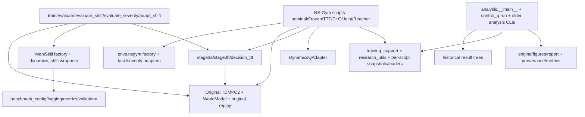

# TD-MPC2 dynamics-shift research refactor: Phase 0 migration plan

Audit basis: `4659c66` (2026-11-19, Asia/Seoul). Public-code comparison: `332f19e`. This document is the sole Phase 0 repository addition. Existing source, result and archive files were not edited. Historical PASS claims are inventory evidence, not validation of future code.

## Scope and invariants

- Keep original `TDMPC2`, `WorldModel`, optimizer targets, replay sampling, MPC, action-repeat, termination/truncation, discount and training update schedule numerically unchanged.
- Keep Dynamics+Q transition record, warmup, 25-decision update cadence, 118 dynamics and 118 Q updates per 3,000-transition stream, detached real latents, original categorical Q target/loss, two fresh Adam optimizers, and target-Q EMA. Treat these as explicit compatibility contracts, not generic strategy defaults.
- Keep all historical checkpoint/snapshot/config/CSV/JSON/NPZ layouts readable. Never rewrite existing results or figures in place. New artifacts use new output directories and retain source hashes and schema/version provenance.
- Preserve public CLI arguments and script paths as thin compatibility entry points until usage and downstream imports are audited. Do not consolidate experimental methods merely because they share file IO.

## A. Current architecture and dependency graph

Primary executable checkout is `tdmpc2/` below the outer repository. Outer `scripts/` is an exact mirror of inner `tdmpc2/scripts/`; outer `experiments/nsgym/` contains a partial earlier mirror. `tests/` at the outer root is empty at this HEAD. The public README and original TD-MPC2 training scripts remain; NS-Gym is an explicit separate factory.

Dependency boundary: original `docker/environment.yaml` pins PyTorch 2.7.1, Gymnasium 0.29.1, MuJoCo 3.1.2, NumPy 1.24.4, TensorDict 0.8.3 and TorchRL 0.8.1; the separate `experiments/nsgym/requirements*.txt` path pins NS-Gym commit `127df4b`, Gymnasium 1.3.0, MuJoCo 3.3.7, NumPy 2.4.6, PyTorch 2.14.0, TensorDict 0.14.3 and TorchRL 0.14.1. The legacy ManiSkill2/SAPIEN/gym boundary and NS-Gym/Gymnasium boundary must remain distinct. `analysis.__main__` imports source adapters and lazy-loads legacy formats; `control_q.run` reads three validated archive directories; `control_q.evaluation` loads CUDA models and simulators. Avoid moving heavy dependencies into read-only imports.

Active entry points: `tdmpc2/tdmpc2/{train,evaluate,evaluate_shift,evaluate_severity,adapt_shift}.py`; `tdmpc2/scripts/{evaluate_shift_suite,evaluate_mechanism_suite,run_stage3b,run_stage3b2,calibrate_physical_severity,...}.py`; `tdmpc2/experiments/nsgym/scripts/{train_nominal,evaluate_frozen,run_dynamics_only_ttt,evaluate_ttt_final,run_dynamics_q,run_reacher_dynamics_q,run_full_joint_rl,evaluate_joint_final,run_reacher_pipeline,analyze_q_planning}.py`; `python -m experiments.nsgym.analysis`; `python -m experiments.nsgym.analysis.control_q.run`; and separate `control_q.evaluation` for real Q-swap control. `...` here means auxiliary audit/probe/report CLIs, not hidden runtime entry points. Preserve their import/CLI contracts during migration.

Complete guarded `__main__` inventory (excluding tests and the three public task-module debug blocks): inner `scripts/`: `analyze_mechanism_artifacts`, `analyze_pairing_archive`, `analyze_physical_response`, `analyze_stage3a_matched`, `analyze_stage3b`, `analyze_stage3b2`, `analyze_stage3b_severity`, `audit_shift_logs`, `audit_shift_simulator`, `calibrate_physical_severity`, `evaluate_mechanism_suite`, `evaluate_shift_suite`, `probe_physical_response`, `run_stage3b`, `run_stage3b2`, `validate_pairing`, `validate_pairing_matrix`, `validate_shift_benchmark`. NS-Gym `scripts/`: `analyze_existing_mechanisms`, `analyze_q_planning`, `audit_nominal_convergence`, `evaluate_frozen`, `evaluate_joint_final`, `evaluate_ttt_final`, `inspect_pusher`, `inspect_reacher`, `plot_results`, `print_severity_commands`, `run_dynamics_only_ttt`, `run_dynamics_q`, `run_full_joint_rl`, `run_reacher_dynamics_q`, `run_reacher_pipeline`, `run_severity`, `smoke`, `train_nominal`, `validate_physics`. Analysis: `analysis.__main__`, `control_q.run`, `control_q.evaluation`. Shell/cluster launchers also include `evaluate_dynamics_shift.sh`, `launch_full_joint_rl.sh`, `run_pusher.sbatch`, `run_reacher.sbatch`. Modules without a guard may still be imported by these entry points and are covered by the migration map.

Public core changed in exactly six copied files relative to `332f19e`: `common/layers.py` (meta ensemble template and dropout mode), `envs/__init__.py` (shift routing), `envs/maniskill.py` (legacy Gym/shift/action-repeat/restore), `envs/wrappers/tensor.py` (seed forwarding), `evaluate.py` (shift logging), and `tdmpc2.py` (planner instrumentation). `common/world_model.py`, replay `common/buffer.py`, `train.py` and trainer files match the public baseline byte-for-byte in the inner checkout.

## B. Proposed canonical package and responsibility boundaries

Create `tdmpc2/research/` inside the executable checkout. Keep `tdmpc2/tdmpc2/` as the algorithm and environment adapter layer. Do not make classes for hashing, seed validation, statistics, file parsing, physics readback or figure calculations when pure functions suffice.

| Component | Owns | Must not own |
|---|---|---|
| `EnvironmentFactory` | Explicit selection of legacy ManiSkill and NS-Gym factories; task adapter construction; seed/reset and observation/action contract validation | TD-MPC2 planning or physics schedule math |
| `AdaptationStrategy` | Narrow protocol for `observe`, scheduled `update`, fixed-parameter audit, `state_dict`; concrete Frozen, DynamicsOnly, DecisionTTT, DynamicsQ and Joint adapters | Cross-stream scheduling or generic reinterpretation of D+Q targets |
| `AdaptationRunner` | One stream's transitions, episode boundaries, method-specific budgets, resume state, logging and strategy orchestration | Optimizer loss definitions or result aggregation |
| `ReplayBuffer` | Research adaptation transition storage and sampling contract; method-specific record schemas and RNG ownership | Replacement of original TD-MPC2 training replay (`common/buffer.py`) |
| `EvaluationRunner` | Frozen/shifted/nominal retention and fixed-bank prediction evaluation; RNG and parameter immutability | Training updates or figure styling |
| `CheckpointComposer` | Versioned load/save adapters for original nominal checkpoints, Stage 3 snapshots, Dynamics+Q and Joint snapshots; hashes and provenance | Silent conversion or rewrite of historical files |
| `PlanningAnalyzer` | Read-only Q distribution, terminal value, candidate ranking, MPPI trace and counterfactual calculations | Environment rollouts, training, rendering |
| `ReportBuilder` | Canonical records to tables/figures/guide with source lineage and reproducible intervals | Source discovery or scientific metric redefinition |

Keep discovery, source adapters, schemas, bootstrap, metrics, manifest validation and hash calculation as modules of pure functions/dataclasses. Keep real Q-swap evaluation under `EvaluationRunner`, separate from the read-only `PlanningAnalyzer` and `ReportBuilder`.

## C. Old-to-new migration map

| Current source | Proposed owner | Compatibility rule |
|---|---|---|
| `tdmpc2/envs/__init__.py`, `envs/maniskill.py`, `envs/nsgym/*`, `envs/wrappers/dynamics_shift/*` | `research/environment.py` coordinates existing factories; shift and NS-Gym implementation remains in `envs/` | Keep old `make_env` and explicit `envs.nsgym.make_env`; no new implicit imports |
| `common/stage3a.py`, `common/decision_ttt.py`, `common/dynamics_q.py` | `research/strategies/{frozen,dynamics_only,decision_ttt,dynamics_q}.py` with adapters | Preserve constructors, state keys, gradients, ordering and exact D+Q semantics through forwarding imports |
| `scripts/run_full_joint_rl.py` training update procedure | `research/strategies/joint.py` plus `research/adaptation_runner.py` | Keep original agent update call and update counts; old CLI delegates |
| `common/stage3b.py`, `adapt_shift.py`, `scripts/run_stage3b*.py`, NS-Gym `run_*`/`reacher_pipeline.py` | `research/adaptation_runner.py` plus small task/method policies | Preserve stage and stream identities, resume markers and original CLI names |
| `common/stage3a.py` deque, `common/dynamics_q.py` deque, NS-Gym runner replay records | `research/replay.py` adapters | Retain distinct sample-without-replacement and original Joint replay behavior; never replace original `common/buffer.py` |
| `common/shift_evaluation.py`, `severity_evaluation.py`, `evaluate_shift.py`, `evaluate_severity.py`, NS-Gym `evaluate_*`, `training_support.evaluate` | `research/evaluation.py` plus domain-specific environment/metric functions | Preserve seed sets, step semantics, output fields and held-out boundaries |
| `training_support.{checkpoint,load_checkpoint}`, NS-Gym `snapshot/load_final/restore/load_adapted`, `TDMPC2.save/load` callers | `research/checkpoints.py` | Read every legacy layout first; write new version only to new directories; leave agent save/load behavior intact |
| `common/planner_trace.py`, `common/mechanism_analysis.py`, `scripts/q_planning_core.py`, `analysis/control_q/{models,diagnostics/*}.py` | `research/planning.py` for shared numerical analysis; simulator diagnostics stay separate | Preserve original Q decode, random-head and RNG semantics; old import paths forward |
| `analysis/{discovery,sources,schema,engine,metrics,statistics,regression}.py`, `analysis/control_q/{data,metrics,figures,report,provenance,run}.py` | `research/reporting/{sources,records,metrics,render}.py` plus `ReportBuilder` | Keep historical column names, masks, missingness, CI unit, figure bytes and old CLIs |
| `common/benchmark_*`, `shift_protocol.py`, `severity_protocol.py`, `scripts/research_utils.py` | Shared pure-function modules (`research/contracts.py`, `research/provenance.py`) | Migrate only after call-site inventory and exact fixture comparison |
| Outer `scripts/`, outer `experiments/nsgym/` | Canonical inner checkout with forwarding wrappers only if external use requires them | No removal without import/command inventory and migration release note |

## D. Merge, keep and delete candidates (no Phase 0 deletion)

| Candidate | Decision | Evidence / gate |
|---|---|---|
| Outer `scripts/` vs inner `tdmpc2/scripts/` | Merge candidate | 23/23 code/config script pairs are byte-identical. Check external invocations before dropping a copy. |
| Outer `experiments/nsgym/` vs inner copy | Partial merge candidate | 47 shared files match; `plot_results.py` differs substantially and `print_severity_commands.py` differs slightly. Inner has 70 more files in the inspected source/config/validation set. Review both divergent files manually. |
| `halfcheetah.py` vs `pusher.py` NS-Gym adapters | Extract common behavior candidate | ~0.69 line similarity and identical reset implementation, but preserve task-specific observations/rewards and physical parameter handling. |
| `training_support.tree_hash` vs `control_q.models` tree visitor | Pure-function merge candidate | AST-equivalent visitor body; compare exact digest inputs and call contexts. |
| `inspect_pusher.py` vs `inspect_reacher.py` | Shared inspection helper candidate | Identical CLI `main` body; keep task-specific probes separate. |
| NS-Gym run/evaluation/checkpoint scripts | Partial merge candidate | Similar orchestration but different scientific methods, schemas and update schedules. Do not collapse algorithms. |
| `analysis/control_q` recent figure consolidation | Keep, validate | HEAD `4659c66` added `data.py`, `figures.py`, `report.py`; removed older rendering CLIs. Q-swap remains separate and a full 108-stream closed-loop evaluation is not in the validated source set (`NOT_MEASURED`). |
| `smoke.py`, `train_*_pilot.yaml`, `run_stage3b*.py`, `stage3*.yaml`, stage-named reports | Keep as compatibility/validation candidates | Smoke/pilot are bounded diagnostics; stage names are historical protocol references. Mark obsolete only after usage, result-schema and manifest audit. |
| Archived ManiSkill2 docs/source snapshots and `results/nsgym/*` | Keep immutable | Source hashes and published historical comparisons depend on them. A prior commit already removed one physical-calibration tree; recoverability must be checked before any future cleanup. |
| Empty `__init__.py` and small pure utility functions | Keep as modules/functions | Classes add no lifecycle benefit. |

## E. Regression and numerical parity gates

1. Capture pristine HEAD input hashes, environment/dependency versions, config resolutions, CLI `--help`, fixture artifacts and historical output schemas. Use new temporary output locations only.
2. Run existing fast tests from inner checkout: `tests/`, `experiments/nsgym/tests/`, `experiments/nsgym/analysis/test_{migration,unified}.py`, Q planning/control tests. Record actual results anew; documented previous PASS counts are not a gate.
3. Characterize exact original-core behavior: model and optimizer state dict keys, device transfer, actor/Q/dynamics losses and gradients, target-Q EMA, MPC score/selected action under controlled RNG, action repeat, timeout flags and replay sample indices.
4. D+Q golden test on identical transition tensors: reward/terminal target, categorical logits and soft-CE, parameter groups, optimizer hyperparameters/state, update trigger sequence (64 warmup/25 interval), 118+118 update count, 118 target updates, snapshot hash and fixed-component immutability. Compare bitwise on same device/software where deterministic; otherwise predeclare dtype-specific tolerances and report deviations.
5. Checkpoint matrix: original nominal, historical Dynamics-only/Decision, D+Q, Joint and Stage 3 snapshots. Load read-only, round-trip into temporary directories, compare state tensors, optimizer/scheduler/replay/RNG fields, missing metadata behavior and no source mutation. Keep original file hashes.
6. Evaluate fixed saved transition banks and deterministic small simulator fixtures. Verify seed pairing, physical readback, action commands vs executed actions, 5-return/4-return wrapping, prediction metrics, row order and provenance. Real simulator/CUDA tests run later on a compatible host; Phase 0 runs none.
7. Reporting parity: consume the same immutable raw source set; compare canonical rows, exclusions, statistical units and intervals, numeric figure inputs, PNG/PDF/HTML bytes or image pixels, manifests and source maps. Any figure or scientific result change fails the phase gate unless separately requested and justified.
8. Every phase ends with a fresh full relevant regression run, diff against frozen baselines, and a written compatibility report. No migration step may infer success from old logs.

## F. Phases 1–4: exact implementation sequence

### Phase 1 — freeze contracts and bridge imports

Inventory all CLI callers/imports and existing schema versions; record hash manifest for representative historical checkpoints/results/figures. Add test fixtures and golden vectors without changing algorithms. Create `research/` package skeleton, pure contract/provenance utilities and forwarding imports. Keep all old CLIs operational. Gate: baseline and bridge produce identical CLI/config/state/metric behavior.

### Phase 2 — environment, replay and adaptation

Introduce `EnvironmentFactory` over existing explicit factories. Extract research `ReplayBuffer` adapters while leaving original training replay untouched. Move Frozen/DynamicsOnly/DecisionTTT/DynamicsQ/Joint implementations behind `AdaptationStrategy` without changing update math. Add `AdaptationRunner` for stream lifecycle, schedules, budgets and resume; migrate one method at a time in order Frozen → Dynamics-only → Decision → D+Q → Joint. Keep wrappers and old import paths. Gate each method with method-specific gradient, RNG, update-count and artifact parity; D+Q golden test is mandatory before advancing.

### Phase 3 — checkpoint and evaluation composition

Implement `CheckpointComposer` readers for all existing formats before any new writer. Implement `EvaluationRunner` for fixed-bank prediction and held-out control. Migrate evaluators individually, preserve one-to-one output schema and provenance. Only introduce a versioned new writer after round-trip tests for old formats pass. Gate: source files unchanged, historical snapshots load, saved-bank and deterministic evaluation rows match.

### Phase 4 — planning, reporting and cleanup decision

Move shared Q/planner numerics to `PlanningAnalyzer` while retaining real Q-swap as a separate evaluation. Move canonical source adapters and rendering to `ReportBuilder`; keep `control_q.run` and `analysis.__main__` as public CLIs. Check complete raw-to-report and figure parity with immutable sources. Only then prepare a separate reviewed cleanup proposal for exact mirrors, obsolete stage wrappers and smoke/pilot paths. No historical artifact deletion is implicit. Gate: scientific tables and figures unchanged, all source/provenance maps valid, fresh regression report PASS.

## Phase 0 evidence and unresolved checks

- `git status --porcelain=v1 -uall` before this document: only `.DS_Store` modified. Do not revert or stage it as part of the refactor.
- SHA-256 grouping of active Python/config/shell files found outer/inner mirrored script and NS-Gym files. AST comparison found identical `HalfCheetah`/`Pusher` reset, a tree-hash visitor and inspection CLI. Similarity is a refactor clue, not proof of equivalent semantics.
- Existing validation logs and `analysis/REFACTOR_STATUS.md` report earlier PASS/caveats. No tests, training or expensive evaluation were run in Phase 0.
- `control_q` HEAD describes 36 conditions/108 streams in three archived inputs; optional closed-loop Q-swap figure requires separate full real evaluation. Current code uses fixed source names and hard coverage assertions, so generalizing report inputs is a separate decision.
- Check historical references from results, shell scripts, notebooks, external server jobs and archive manifests before marking any candidate obsolete or changing a path.

## Phase 1B-1 implementation record (2026-11-20)

The inner checkout now contains `tdmpc2/research/dynamics_shift/` with typed configuration, state, strategy, runner and replay boundaries, transparent delegates and a composition root. `docs/research/ARCHITECTURE.md` records the package tree, class responsibilities and old-to-new mapping; `docs/research/ADAPTATION_METHODS.md` records method-specific invariants. Existing constructors, CLI modules, replay owners, snapshots, evaluation and all six upstream-modified core files remain unchanged. Decision TTT inherits Dynamics-only's exact learning objective and optimizer step and changes the update schedule and scheduler state only.

Local bridge and immutable Phase 1A golden execution: **43 passed, 2 subtests passed**. Additional Stage 3 runner/matched/Q-planning contracts: **15 passed**. The D+Q bridge test compares direct and delegated CPU updates for identical model state, sampled replay indices, adapter RNG state, losses, optimizer state, EMA and update counters. **BLOCKED — new-code server validation:** this Mac cannot resolve or SSH to server4; the user is running the three requested CUDA/NS-Gym commands remotely, and their results have not yet been received. Previous Phase 1A PASS results do not validate this bridge on CUDA or in a simulator. The original golden fixtures were read only and no loss, optimizer or training implementation moved.

Phase 1B-2 remains outside this phase. Do not migrate algorithm code, rename legacy modules, or delete historical files based on this bridge alone.
